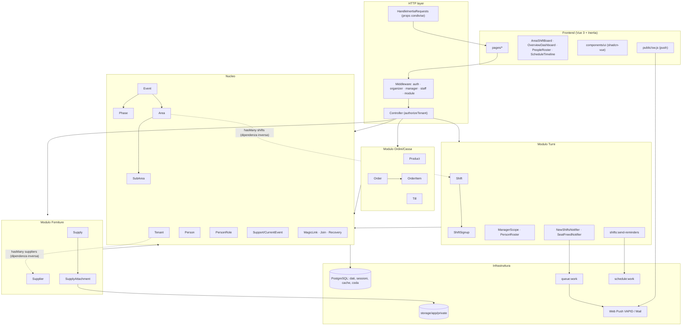
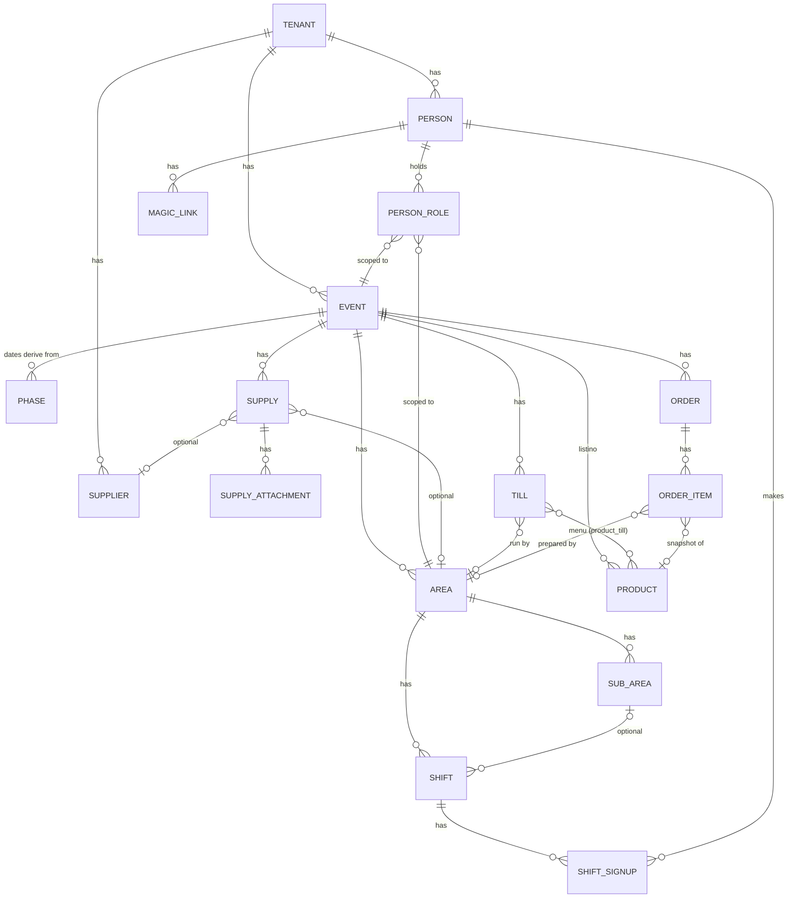
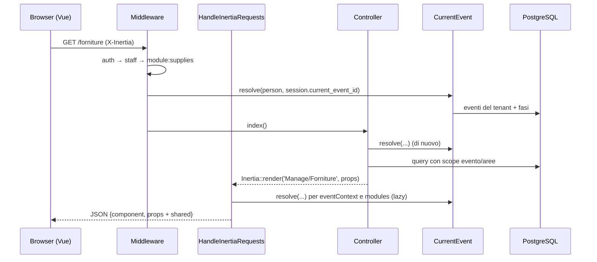
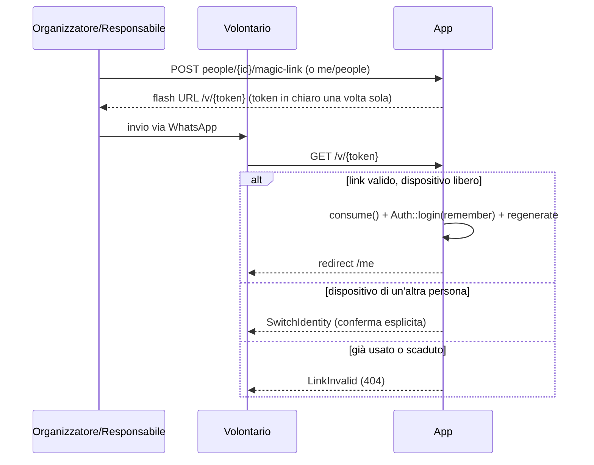
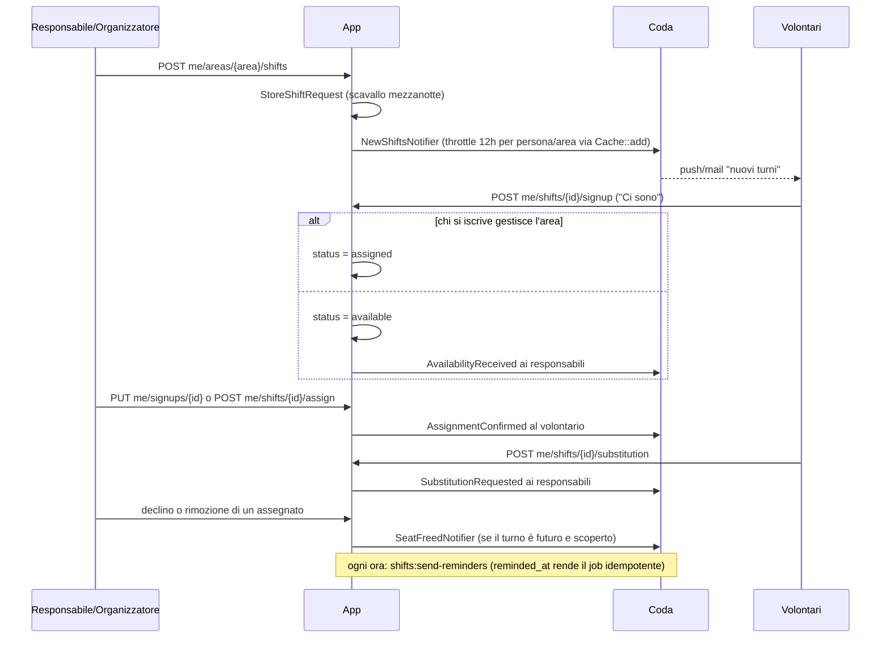

# 01 — Architettura: lettura indipendente del codice

> Revisione architetturale di Fieste ricostruita **solo dal codice**.
> Branch analizzato: `claude/bold-goldberg-xs81r4` (HEAD `442c38e`).

## 0. Metodo e perimetro

**Letti:** tutto `app/`, `bootstrap/`, `routes/`, `config/` (le parti
rilevanti), `database/migrations/`, `database/seeders/`, il frontend in
`resources/js/` (pagine, componenti di dominio, layout, `lib/`), `public/sw.js`,
`Dockerfile`, `docker-compose.yml`, `docker/`, `scripts/`, `DEPLOY.md`,
`.github/workflows/`, `phpunit.xml` e la struttura dei test.

**Esclusi di proposito**, per non conoscere le motivazioni originali:
`docs/dominio-e-decisioni.md`, `docs/schema-core.md`,
`docs/review/CLAUDE.original.md`. Non li ho aperti.

**Avvertenza.** I commenti nel codice citano spesso codici di decisione
(D5, D6, D10, D11, D13, D15–D21) e a volte ne riassumono il contenuto in una
riga (per esempio `app/Http/Middleware/EnsureOrganizer.php:10-13`). Uso questi
riassunti come indizi, ma non conosco il testo delle decisioni. Per ogni
motivazione indico da dove viene:

- **[dichiarato]**: la motivazione è scritta in un commento o in un docblock;
- **[ricostruito]**: la motivazione è una mia deduzione da struttura, nomi, test e storia git;
- **[ipotesi]**: è plausibile, ma il codice non basta a confermarla.

I riferimenti sono `path:riga` relativi alla radice del repository.

---

## 1. Vista d'insieme

Fieste è un **monolite Laravel 12 server-driven**. Il frontend è una SPA
Vue 3 servita tramite **Inertia 2**: il server non espone un'API JSON, ogni
controller restituisce `Inertia::render('Pagina', props)` oppure un redirect.
È **multi-tenant su un unico database**, con una colonna `tenant_id` su ogni
tabella di dominio. Un'unica immagine Docker esegue tre processi (web, worker
della coda, scheduler) e PostgreSQL contiene sia i dati sia sessioni, cache e
coda.

| Directory | Responsabilità |
|---|---|
| `bootstrap/app.php` | Composizione: rotte, alias dei middleware di ruolo e modulo, proxy fidati, redirect di guest e utenti autenticati (`bootstrap/app.php:20-58`) |
| `routes/web.php` | Pagine staff dell'evento corrente e moduli verticali (Forniture, Cassa/Comande) |
| `routes/manage.php` | CRUD solo organizzatore: persone, eventi, aree, sotto-reparti, turni, iscrizioni, responsabili |
| `routes/volunteer.php` | Accesso senza password (`/v`, `/join`, `/recover`) e la pagina `/me` con le sue azioni, comprese quelle di gestione dei responsabili |
| `routes/auth.php`, `routes/settings.php` | Login, registrazione e impostazioni account (dallo starter kit Laravel Vue) |
| `app/Models` | 17 modelli Eloquent; le invarianti di dominio stanno negli hook `saving` e `deleting` |
| `app/Enums` | Tutti i vocabolari chiusi (ruolo, stato iscrizione, fase, modulo, …) come backed enum |
| `app/Support` | Logica condivisa senza stato: `CurrentEvent`, `ManagerScope`, `PersonRoster`, due notifier |
| `app/Http/Middleware` | Autorizzazione grossolana per ruolo e modulo, più le props condivise di Inertia |
| `app/Notifications` | 8 notifiche in coda, sui canali web push e mail |
| `app/Console/Commands` | Promemoria dei turni (cron orario) |
| `resources/js/pages` | Una pagina Vue per vista Inertia |
| `resources/js/components` | Componenti di dominio riusati tra ruoli (`AreaShiftBoard`, `OverviewDashboard`, `PeopleRoster`, `ScheduleTimeline`) e `ui/` shadcn-vue |
| `public/sw.js` | Service worker per le sole notifiche push |
| `Dockerfile`, `docker-compose.yml`, `docker/` | Immagine FrankenPHP e topologia su una sola VPS |

---

## 2. Mappa dei moduli

### 2.1 Moduli e responsabilità

Il codice distingue esplicitamente un **nucleo** che non si può spegnere e dei
**moduli verticali** attivabili per evento (`app/Enums/Module.php:5-15`):
`shifts`, `supplies`, `orders`.

**Nucleo**

| Componente | File | Responsabilità |
|---|---|---|
| Tenant | `app/Models/Tenant.php` | L'associazione: nome, slug, token d'invito (`:42-54`), impostazioni JSON (`:33-36`) |
| Person | `app/Models/Person.php` | Identità unica: volontario, responsabile e organizzatore sono tutti `Person` (`:18`). Gestisce autenticazione, preferenze di notifica (`:65-68`), anonimizzazione GDPR (`:130-153`), aree gestite (`:160-187`) e magic link (`:198-213`) |
| PersonRole | `app/Models/PersonRole.php` | Ruoli con ambito area ed evento; oggi solo `area_manager` (`app/Enums/Role.php:9-12`) |
| Event, Phase | `app/Models/Event.php`, `app/Models/Phase.php` | Edizione con fasi (preparazione, servizio, smontaggio). Le date dell'evento derivano dalle fasi (`Event.php:62-73`) |
| Area, SubArea | `app/Models/Area.php`, `app/Models/SubArea.php` | Reparti per edizione e sotto-reparti leggeri (`SubArea.php:11-14`) |
| CurrentEvent | `app/Support/CurrentEvent.php` | Contesto "evento corrente" per le viste staff |
| Accesso | `app/Http/Controllers/Volunteer/{MagicLink,Join,Recovery}Controller.php`, `app/Models/MagicLink.php` | Accesso senza password per i volontari |
| Autorizzazione | `app/Http/Middleware/Ensure*.php`, `app/Http/Controllers/Controller.php:13-16` | Verifiche di ruolo, di modulo e di tenant |

**Modulo Turni** (`shifts`): `Shift`, `ShiftSignup`, i controller
`ShiftController`, `SignupController`, `Manage/ShiftManagementController` e
`Volunteer/{Home,Signup,ManagerShift,ManagerPeople}Controller`, i servizi
`Support/{NewShiftsNotifier,SeatFreedNotifier,ManagerScope,PersonRoster}`,
il comando `SendShiftReminders` e le notifiche relative.

**Modulo Forniture** (`supplies`): `Supplier` (rubrica per tenant,
`app/Models/Supplier.php:11-14`), `Supply` (per evento), `SupplyAttachment`
(file sul disco privato, `app/Models/SupplyAttachment.php:9-15`) e tre
controller.

**Modulo Ordini/Cassa** (`orders`): `Product` (listino per evento), `Till`
(punto cassa legato a un'area, `app/Models/Till.php:13-17`), `Order` e
`OrderItem` (righe con snapshot e stato per la cucina), più `OrderController`,
`KitchenController`, `TillController` e `ProductController`.

### 2.2 Diagramma dei componenti

### 2.3 Modello dati (semplificato)

Ogni tabella di dominio ha `tenant_id` con `cascadeOnDelete`, per esempio
`database/migrations/2026_06_11_000007_create_shifts_table.php` e
`2026_07_24_000009_create_order_items_table.php`.

### 2.4 Dipendenze tra moduli

| Da → A | Esiste? | Evidenza |
|---|---|---|
| Forniture → Nucleo (Area, SubArea, Event, Tenant) | sì | `app/Models/Supply.php:64-82`, `SupplyController.php:120-122` |
| Ordini → Nucleo (Area, SubArea, Event) | sì | `app/Models/Product.php:43-56`, `Till.php:35-43` |
| Ordini ↔ Forniture | **no** | nessun riferimento incrociato nei model o nei controller dei due moduli |
| Ordini/Forniture → Turni | **no** | nessun riferimento a `Shift` o `Signup` nei file dei due moduli |
| **Nucleo → Forniture** | sì (inversa) | `app/Models/Tenant.php:61-64` (`suppliers()`) |
| **Nucleo → Turni** | sì (profonda) | `Area::shifts` (`Area.php:43-46`), `Person::signups` (`Person.php:95-98`), `Person::anonymize` (`Person.php:132-134`), `ManagerScope`, `PersonRoster` e `DashboardController` leggono i turni |

Conclusione: Forniture e Ordini sono davvero verticali e parlano solo col
nucleo. **Turni** è dichiarato modulo (`Module.php:12`), ma è intrecciato con
nucleo, dashboard, elenco persone e anonimizzazione. Il commit `6c52773`
("shifts are a peer module") esprime l'intenzione di renderlo un modulo alla
pari, ma la separazione è ancora soprattutto nominale (vedi §5.3).

---

## 3. Flussi principali

### 3.1 Richiesta tipo (Inertia)

- Le props condivise sono `auth.user`, `auth.role`, `flash`, `eventContext`
  e `modules`; le ultime due sono closure valutate in modo lazy
  (`app/Http/Middleware/HandleInertiaRequests.php:40-66`).
- Il ruolo viene calcolato a ogni richiesta (`HandleInertiaRequests.php:119-130`)
  e guida la sidebar unica (`resources/js/components/AppSidebar.vue:29-65`).
- Le mutazioni sono POST/PUT/DELETE che rispondono `back()`. Inertia ricarica
  la pagina corrente con le props aggiornate. Gli errori di validazione tornano
  come `errors` con messaggi in italiano scritti nel controller (per esempio
  `EventController.php:251-258`).

### 3.2 Contesto "evento corrente"

- Il contesto è salvato in sessione (`current_event_id`) da
  `EventContextController::update` (`app/Http/Controllers/EventContextController.php:15-25`),
  che accetta solo gli eventi visibili alla persona.
- `CurrentEvent::resolve` (`app/Support/CurrentEvent.php:47-61`) restituisce la
  scelta salvata se è ancora valida; altrimenti la prima edizione non ancora
  conclusa; altrimenti l'ultima passata.
- `CurrentEvent::options` (`CurrentEvent.php:23-40`) restituisce tutti gli
  eventi del tenant all'organizzatore, e al responsabile solo gli eventi in
  cui ha un ruolo. **Il volontario semplice non ha opzioni**: `resolve`
  restituisce `null` e `/me` mostra i turni futuri di tutte le edizioni
  (`Volunteer/HomeController.php:24-31`).
- Lo stesso schema (resolve, poi filtro per `event_id` e aree gestite) si
  ripete in Dashboard, Calendar, Areas, Shifts, Supply, Order, Kitchen, Till
  e Product.

### 3.3 Accesso e identità

I canali d'ingresso sono quattro:

1. **Magic link.** Viene salvato solo l'hash SHA-256 (`MagicLink.php:36-45`).
   Il link è monouso (`:47-54`) e scade in 7 giorni. Generarne uno nuovo
   revoca il precedente e ruota `remember_token`, che fa da "kill switch" su
   tutti i dispositivi (`Person.php:189-213`). Controller:
   `Volunteer/MagicLinkController.php:14-78`.
2. **Link d'invito del tenant.** Un unico link da condividere con tutti
   (`/join/{token}`). Il volontario si registra col solo nome (telefono
   facoltativo) ed entra subito con sessione remember
   (`Volunteer/JoinController.php:40-65`). Il token si può rigenerare
   (`PersonController.php:37-42`).
3. **Recupero self-service.** Con un'email il sistema invia un nuovo link; con
   solo il telefono marca `link_requested_at` e l'organizzatore lo vede in
   elenco (`Volunteer/RecoveryController.php:27-45`, migrazione
   `2026_06_12_000002`). La risposta non rivela se il contatto esiste.
4. **Password.** È l'account "classico" dello starter kit. L'organizzatore lo
   crea registrandosi, cosa che crea anche il tenant
   (`Auth/RegisteredUserController.php:35-68`). Gli altri lo ottengono tramite
   un "account invite", cioè un token del password broker consegnato a mano
   (`PersonController.php:101-133`).

Esiste **un solo guard**, con provider `people`
(`config/auth.php:46-47,69-72`). Gli ospiti che aprono una pagina
`volunteer.*` vengono mandati a "link non valido", tutti gli altri al login
(`bootstrap/app.php:44-48`). Dopo il login la destinazione dipende dal ruolo
(`Auth/AuthenticatedSessionController.php:39-46`).

### 3.4 Ciclo di vita di un turno

Riferimenti:

- `Volunteer/SignupController.php:29-69` per l'iscrizione, con auto-conferma
  di chi gestisce l'area; `:131-161` per la moderazione; `:183-230` per
  l'assegnazione diretta, con creazione della persona al volo.
- Notifier: `app/Support/NewShiftsNotifier.php:20-39` e `app/Support/SeatFreedNotifier.php:20-48`.
- Promemoria: `app/Console/Commands/SendShiftReminders.php:16-39`, schedulato
  in `routes/console.php:11-12`.
- Le sovrapposizioni di orario sono **permesse ma segnalate**, sia lato
  volontario (`Volunteer/HomeController.php:49-62`) sia lato gestione, guardando
  tutto il tenant (`Manage/ShiftManagementController.php:40-68`).
- La "lista d'attesa" è implicita: niente impedisce iscrizioni `available`
  oltre `needed_people`.

### 3.5 Cassa → Comande (KDS)

- **Vendita.** `OrderController::store` (`app/Http/Controllers/OrderController.php:90-152`)
  calcola la cassa corrente dalla sessione e, se la cassa ha un menu, limita i
  prodotti a quel menu (`:105`). Poi, in una transazione:
  1. assegna il numero d'ordine progressivo `max+1` per evento (`:121`);
  2. crea le righe con nome, prezzo e area copiati dal prodotto (snapshot) e
     con stato `served` se il prodotto non ha area, altrimenti `pending` (`:134-145`);
  3. calcola il totale lato server.
- **Cucina.** `KitchenController::index` (`KitchenController.php:24-66`) mostra
  le righe `pending` e `ready` dell'area scelta, eventualmente filtrate per
  sotto-reparto. La pagina fa polling ogni 15 secondi con
  `router.reload({ only: ['items'] })` quando la scheda è visibile
  (`resources/js/pages/Manage/Comande.vue:51-63`). `update` sposta lo stato
  della riga e registra `ready_at` (`:71-90`).
- **Casse.** Una cassa appartiene a un'area: il responsabile di quell'area (o
  l'organizzatore) la configura. Se il menu è vuoto, la cassa vende tutto il
  listino (`Till.php:58-71`, `TillController.php:112-124`).

### 3.6 Attivazione dei moduli per evento

- `events.enabled_modules` è una lista JSON. Il valore `null` significa "mai
  configurato" e vale come default, cioè solo `shifts` (`Event.php:31-45`,
  `Module.php:22-25`).
- Il middleware `module:<key>` risponde 404 se il modulo è spento sull'evento
  corrente (`EnsureModuleEnabled.php:17-29`). La sidebar nasconde le voci
  (`AppSidebar.vue:31-55`, `HandleInertiaRequests.php:71-84`).
- Spegnere un modulo nasconde soltanto: i dati restano
  (`EventController.php:111-127`). La migrazione abilita tutti i moduli sugli
  eventi già esistenti "perché nessuno perda dati" (`2026_07_24_000011_…:21-26`).

### 3.7 Deploy e runtime

- L'immagine è costruita in tre stage: composer, node, runtime FrankenPHP con
  PHP 8.3 (`Dockerfile:7-56`).
- All'avvio `entrypoint.sh` crea le cache di config, rotte e view; solo il
  container web esegue le migrazioni (`docker/entrypoint.sh:4-14`,
  `docker-compose.yml:15`).
- Compose avvia i servizi `app`, `worker`, `scheduler` e `db`, più due profili
  opzionali di Cloudflare Tunnel (`docker-compose.yml:8-99`). Sessioni, cache e
  coda usano il driver `database` (`.env.docker.example`, sezione "Everything on Postgres").
- Il redeploy automatico è un cron che fa `git pull` e `compose up --build`
  (`scripts/deploy.sh`, `scripts/deploy.ps1`).

---

## 4. Decisioni architetturali implicite

| # | Decisione | Evidenza | Motivazione più probabile |
|---|---|---|---|
| 1 | **Un'unica identità `people`**; "organizzatore" è un flag, "responsabile" è un ruolo con ambito di area | `Person.php:80-88`, `Role.php:5-8`, migrazione `2026_07_22_000001_unify_identity_into_people.php:8-15` | [dichiarato + ricostruito] All'inizio esistevano `users` (organizzatori) e `people` (volontari) separati. Un organizzatore però è anche un volontario che si iscrive ai turni, e un responsabile è un volontario con un ruolo. Due identità avrebbero creato duplicati e due guard. Unificare semplifica autorizzazione e iscrizioni. |
| 2 | **Volontari senza password**: magic link monouso + sessione remember lunga | `Person.php:189-213`, `MagicLinkController.php:62-70` | [dichiarato + ricostruito] Utenti poco tecnologici, su smartphone, raggiunti via WhatsApp: niente password da ricordare. Il link monouso limita i danni se viene inoltrato, e il remember evita di dover rientrare. |
| 3 | **Mai "dirottare" un dispositivo condiviso** (pagina SwitchIdentity) | `MagicLinkController.php:32-40`, `JoinController.php:34-36` | [dichiarato] Telefoni di famiglia condivisi: un link non deve scollegare in silenzio un'altra persona. |
| 4 | **Multi-tenancy a riga** con `tenant_id` ovunque, controllo esplicito nel controller, **cross-tenant = 404** | `Controller.php:10-16`, tutte le migrazioni | [ricostruito] È il modello SaaS più economico (un solo DB). Il 404 non rivela l'esistenza di record di altri tenant. `tenant_id` anche sulle tabelle figlie permette controlli senza join. Non c'è un global scope: è una scelta di esplicitezza, non necessariamente consapevole. |
| 5 | **Date derivate, mai duplicate**: evento ← fasi, fase del turno ← `starts_at` | `Event.php:62-81`, `Shift.php:66-73`, commenti nelle migrazioni events/shifts | [dichiarato] Un'unica fonte di verità evita incoerenze quando le fasi cambiano. Per questo le fasi non possono sovrapporsi (`Phase.php:41-52`). |
| 6 | **Invarianti nel modello** (hook `saving`, `DomainException`) oltre alla validazione HTTP | `Phase.php:34-53`, `Shift.php:37-44`, `PersonRole.php:32-39` | [ricostruito] Proteggono il dominio anche da seeder, tinker e codice futuro; la validazione HTTP resta per i messaggi all'utente. |
| 7 | **"Soft membership"**: si appartiene a un'area perché ci si è iscritti, non per dichiarazione | `PersonRoster.php:25-29`, `Volunteer/HomeController.php:40-47`, `NewShiftsNotifier.php:26-33` | [dichiarato] Rispecchia la realtà di una sagra (si dà una mano dove serve) ed evita un'anagrafica di appartenenze da mantenere. |
| 8 | **L'auto-iscrizione di chi gestisce l'area è già confermata** | `Volunteer/SignupController.php:25-36` | [dichiarato] Chi confermerebbe è la stessa persona: un passaggio in meno. |
| 9 | **Snapshot delle righe d'ordine** e **FK `nullOnDelete`** sui riferimenti storici | migrazione `2026_07_24_000009` (docblock), `2026_07_24_000005` (docblock), `ProductController.php:43-44`, `TillController.php:53-54` | [dichiarato] Modificare o cancellare un prodotto, un fornitore o una cassa non riscrive gli scontrini e le forniture passati. |
| 10 | **Anonimizzazione GDPR** invece della cancellazione fisica | `Person.php:124-153`, `Volunteer/ProfileController.php:70-92`, `Settings/ProfileController.php:44-71` | [dichiarato] Diritto all'oblio senza perdere lo storico aggregato dei turni (anche per statistiche future). L'ultimo organizzatore non può cancellarsi, altrimenti il tenant resterebbe senza amministratore. |
| 11 | **JSON per configurazioni piccole** (impostazioni del tenant, preferenze di notifica, moduli abilitati) con "chiave assente = default" | `Tenant.php:29-36`, `Person.php:61-68`, migrazione `2026_07_24_000011` (docblock) | [dichiarato] Pochi interruttori non giustificano tabelle pivot. "Assente = attivo" permette di aggiungere nuove chiavi senza migrazioni. |
| 12 | **Moduli verticali senza cartella `Modules/`**, struttura Laravel standard | docblock di `2026_07_24_000004_create_suppliers_table.php` ("no Modules/ folder (D13)") | [dichiarato + ricostruito] Sviluppatore singolo: si evitano boilerplate e pacchetti di modularizzazione; il confine resta logico (enum, middleware, naming). |
| 13 | **Logica condivisa in classi statiche `Support/*`**, senza service container, Policy o Action | `app/Support/*.php`, `AppServiceProvider.php:12-23` vuoto | [ricostruito] Pragmatismo: funzioni pure con lo stesso calcolo per viste di ruoli diversi ("same numbers the same way", `ManagerScope.php:12-16`). |
| 14 | **Una sola shell e un solo menu per organizzatore e responsabile**: stesse viste, ambito diverso | `AppSidebar.vue:22-28`, `ManagerAreaController.php:14-19`, `DashboardController.php:42-44` | [dichiarato] Meno codice e meno da imparare: il responsabile vede ciò che vede l'organizzatore, limitato alle sue aree. |
| 15 | **Inertia senza API**; Ziggy per i nomi delle rotte nel frontend | `app.ts:25-37`, `resources/views/app.blade.php:16` | [ricostruito] È lo starter kit ufficiale Laravel + Vue: produttività per uno sviluppatore solo e niente doppio contratto API/DTO. |
| 16 | **Starter kit Laravel Vue + shadcn-vue (radix-vue) + Tailwind 3** | `composer.json:3`, `components.json`, `resources/js/components/ui/*` | [ricostruito] Partenza veloce con componenti accessibili già pronti. |
| 17 | **Web push come canale primario**, mail secondaria; PWA con manifest dinamico e service worker minimale | `PushSubscriptionController.php:9-12`, `SendShiftReminders.php:22-27`, `routes/web.php:24-40`, `public/sw.js:1-2` | [dichiarato] Molti volontari hanno solo il telefono e nessuna email; le notifiche push non costano (gli SMS sì). |
| 18 | **Tutto su Postgres** (sessioni, cache, coda); niente Redis | `docker-compose.yml:1-4`, `.env.docker.example` | [dichiarato] Costo minimo, una VPS da circa 5 €, meno servizi da gestire per chi fa self-hosting. |
| 19 | **FrankenPHP/Caddy** con HTTPS automatico; Cloudflare Tunnel per l'hosting domestico | `Dockerfile:3-5`, `docker/Caddyfile`, `DEPLOY.md` | [dichiarato] Self-hosting accessibile ad associazioni senza competenze sistemistiche, anche dietro CGNAT. |
| 20 | **Un'unica immagine per SaaS e self-hosting** | `Dockerfile:3-4` ("D11") | [dichiarato] Open core: un solo artefatto da mantenere. |
| 21 | **URL brevi** (`/v/`, `/join/`) e **condivisione via WhatsApp** dall'interfaccia | `routes/volunteer.php:15`, `AreaShiftBoard.vue:424,445` | [dichiarato] Il canale reale di comunicazione è WhatsApp. |
| 22 | **Testi e messaggi di validazione in italiano scritti nel codice** invece che in file di traduzione | ad esempio `PersonController.php:162-169` | [ricostruito] Prodotto monolingua per ora; il codice resta in inglese per convenzione. |
| 23 | **Notifiche ad alto volume con throttle via cache** (`Cache::add`) invece di una tabella | `NewShiftsNotifier.php:34-36` | [ricostruito] Throttle approssimativo ma senza schema; va bene se va perso. |
| 24 | **Test di feature su SQLite in memoria**, con migrazioni compatibili (rami `if sqlite`) | `phpunit.xml:25-26`, `2026_07_22_000001_…:63-75` | [ricostruito] Test veloci in CI senza un Postgres; il prezzo è un po' di codice condizionale nelle migrazioni. |
| 25 | **Allegati sul disco privato `local`**, scaricabili solo da una rotta autorizzata | `SupplyAttachment.php:9-15`, `SupplyAttachmentController.php:45-52`, `config/filesystems.php:33-35` | [dichiarato] Le fatture non devono essere pubbliche. |

---

## 5. Incoerenze, sovra- e sotto-progettazione

Ogni voce indica gravità (A = alta, M = media, B = bassa) e uno scenario concreto.

### 5.1 Doppio percorso di gestione turni e iscrizioni (M, sovra-progettato e incoerente)

- Le rotte dell'organizzatore per turni e iscrizioni (`routes/manage.php:35-40`:
  `shifts.store`, `shifts.update`, `shifts.destroy`, `signups.update`,
  `signups.destroy`) **non sono usate dal frontend**. Gestione turni, anche per
  l'organizzatore, chiama solo le rotte `/me/...`:
  - `resources/js/components/AreaShiftBoard.vue:135,158,179,198`;
  - `resources/js/components/ModeratedSignupList.vue:26-41`.
- Le stesse rotte organizzatore sono però **testate**
  (`tests/Feature/Manage/ManageSignupsTest.php:39-87`).
- La logica è quasi identica in due coppie di classi:
  - `SignupController::update` (`app/Http/Controllers/SignupController.php:18-47`)
    e `Volunteer\SignupController::moderate` (`Volunteer/SignupController.php:131-161`);
  - `ShiftController` e `ManagerShiftController`.
  Le coppie divergono già su un punto: `ShiftController::store` verifica solo
  il tenant, `ManagerShiftController` anche `managesArea`.
- Questo duplicato sembra un residuo di quando il responsabile lavorava "dalla
  pagina volontario" (commenti D18 in `Volunteer/ManagerShiftController.php:13-16`),
  poi superato dalla Gestione turni unificata (D20).
- Effetto collaterale sui nomi: azioni di **gestione** vivono nel namespace
  `Volunteer\` e sotto il prefisso `/me` (`routes/volunteer.php:45-51`), mentre
  la pagina `/me` è solo "Prenotazione turni" (`Volunteer/HomeController.php:13-17`).

### 5.2 Autorizzazione dispersa (M, sotto-progettato)

Le verifiche sono distribuite su quattro livelli: middleware di ruolo
(`EnsureOrganizer`, `EnsureStaff`, `EnsureManager`), `authorizeTenant` nella
classe base, e helper privati duplicati come `authorizeArea` e
`authorizeManager` in `SupplyController.php:138-146`, `TillController.php:116-124`,
`SupplyAttachmentController.php:67-76`, `Volunteer/SignupController.php:232-243`,
`Volunteer/ManagerShiftController.php:68-76` e `KitchenController.php:75-76`.
Non ci sono Policy né Gate.

- **Scenario:** si aggiunge un'azione e ci si dimentica la verifica di area.
  Non c'è un punto unico da controllare. Una sottovariante è già presente:
  `OrderController::update` (`OrderController.php:154-161`) verifica solo il
  tenant, quindi qualunque "staff" può segnare pagato o non pagato un ordine
  di qualunque evento.
- **Variante di `EnsureStaff` e `EnsureManager`:** un ruolo di responsabile in
  **qualsiasi** edizione, anche passata, dà accesso alle pagine staff per
  sempre (`EnsureStaff.php:22`, `Person.php:178-187`). Le query poi filtrano
  sull'evento corrente, quindi il danno è limitato, ma il ruolo "manager" non
  scade mai.
- **Costo:** `managesArea` esegue una query per ogni chiamata, e
  `OrderController::index` la chiama per ogni cassa (`OrderController.php:58`)
  insieme a `products()->pluck` per cassa (`:59`). È un N+1 modesto.

### 5.3 Turni "modulo" solo di nome (M, incoerente)

- Spegnere `shifts` blocca soltanto `manage/shifts` (`routes/web.php:66-67`)
  e nasconde le voci di menu.
- Restano invece attivi: `/me` e tutte le sue azioni (`routes/volunteer.php:31-51`,
  senza middleware `module`), il promemoria orario (`SendShiftReminders.php:18-29`,
  che non guarda i moduli), la Dashboard che propone "crea turni"
  (`DashboardController.php:28-37`), il Calendario (`routes/web.php:46-47`,
  senza `module:shifts`) e il roster con il conteggio dei turni.
- **Scenario:** un evento usa solo Cassa. I volontari ricevono comunque i
  promemoria e vedono i turni di quell'evento su `/me`, se esistono.

### 5.4 Middleware `verified` inefficace (B, incoerente)

`Person` non implementa `MustVerifyEmail` (`app/Models/Person.php:18`), quindi
il middleware `verified` su `dashboard` e sul gruppo di `routes/manage.php`
(`routes/web.php:43`, `routes/manage.php:12`) non verifica nulla. Inoltre è
applicato in modo disomogeneo: manca sulle altre pagine dell'organizzatore
(`routes/web.php:46-59`). Le rotte e la UI di verifica email dello starter kit
restano, ma sono inattive.

### 5.5 Unicità dell'email e login ambiguo (M, incoerente)

- Lo schema e le validazioni considerano l'email unica **per tenant**
  (`create_people_table.php:21-22`, `PersonController.php:157-160`), la
  registrazione **globalmente** (`unique:people,email` in
  `Auth/RegisteredUserController.php:40`).
- Il login usa `Auth::attempt(email, password)` senza tenant
  (`app/Http/Requests/Auth/LoginRequest.php:56`).
- **Scenario:** la stessa email ha un account con password in due tenant (per
  esempio un responsabile invitato da due associazioni tramite `accountInvite`,
  che controlla l'unicità solo nel tenant, `PersonController.php:111`). Il login
  entra nel primo record trovato. Il reset password via broker ha la stessa
  ambiguità.
- In più, un volontario con email nel tenant A non può registrarsi come
  organizzatore di una nuova associazione B.

### 5.6 Numerazione degli ordini con `max+1` (M, sotto-progettato)

`'number' => max('number') + 1` dentro una transazione
(`OrderController.php:121`), con indice unico `(event_id, number)`
(`create_orders_table.php:28`). Con il livello d'isolamento predefinito di
Postgres (read committed), due casse che vendono nello stesso istante leggono
lo stesso massimo: la seconda fallisce con un errore 500 e il cassiere deve
ripetere l'ordine. Con una sola cassa il caso è raro; con le casse multiple
appena introdotte (`fde9f9b`) diventa un rischio concreto nel momento di picco.

### 5.7 Allegati non persistiti nel deploy Docker (A, sotto-progettato)

- I file stanno in `storage/app/private` (`config/filesystems.php:33-35`)
  **dentro il container**.
- `docker-compose.yml:101-104` dichiara volumi solo per Postgres e Caddy.
- **Scenario:** ogni `docker compose up -d --build`, compreso l'auto-deploy
  ogni 5 minuti di `scripts/deploy.sh`, ricrea il container e **perde tutte le
  fatture**. Le righe di `supply_attachments` restano e puntano a file che non
  esistono più, e il download risponde 404 (`SupplyAttachmentController.php:49`).
- `DEPLOY.md:154-155` dice "everything is DB-backed and stateless", che non è
  più vero dal commit `bb797c9`.

### 5.8 Replica dell'edizione incompleta (M, incoerente)

`EventController::replicate` (`EventController.php:160-241`) copia fasi, aree,
responsabili, turni e `enabled_modules` (`:190-191`), ma non copia:

- i **sotto-reparti**: aggiunti dopo la replica (commit `c7c1507` contro `069dd37`)
  e mai inclusi;
- il **`sub_area_id`** dei turni (`:227-233`);
- il **listino**, le **casse** e i relativi menu.

**Scenario:** si duplica un'edizione con Cassa attiva e sotto-reparti cucina.
La nuova edizione ha il modulo acceso ma listino vuoto, nessun sotto-reparto e
turni tutti a livello di area.

### 5.9 Ricalcoli ripetuti del contesto (B, efficienza)

`CurrentEvent::resolve` carica **tutti** gli eventi del tenant con le loro fasi
e li ordina in PHP (`CurrentEvent.php:25-39`). In una richiesta tipica a una
pagina modulo viene chiamato fino a 4 volte: middleware modulo, controller,
`eventContext` e `modules`. Lo stesso vale per `managedAreaIds()`, chiamato in
`role()`, in `eventContext()` e nei controller. Oggi non pesa, ma il costo
cresce con il numero di edizioni.

### 5.10 Recupero per telefono che carica tutte le persone (M, scalabilità SaaS)

`RecoveryController::matches` (`Volunteer/RecoveryController.php:69-73`) carica
in memoria **tutte le persone con telefono di tutti i tenant** e confronta le
ultime 9 cifre. Il commento stesso dice "Fine at MVP scale". In un SaaS
multi-tenant la rotta è pubblica (throttle 5/min, `routes/volunteer.php:27-29`)
e quindi è anche un punto di carico abusabile.

### 5.11 Notifiche: duplicazione e un link superato (B)

- `via()` e `when()` sono copiati in ogni notifica, per esempio
  `SeatFreed.php:26-60` e `AvailabilityReceived.php:24-54`. Il filtro
  `wantsNotification` è applicato solo in alcune (`SeatFreed.php:28`).
- `AvailabilityReceived` invita a "tocca per confermare" e linka `/me`
  (`AvailabilityReceived.php:37,46`), ma la moderazione ora è in
  `/manage/shifts` (`Volunteer/HomeController.php:13-17`). Lo stesso vale per
  la `notificationclick` del service worker, che mette a fuoco qualsiasi
  finestra `/me` (`public/sw.js:26-32`).
- Il flash `testNotificationSent` (`OrganizationController.php:45`) non è
  tra le props condivise (`HandleInertiaRequests.php:54-58`), quindi non
  arriva mai al frontend.

### 5.12 Cassa riservata allo "staff" (da chiarire)

Le rotte `cassa` e `orders.*` richiedono `staff`, cioè organizzatore o
responsabile (`routes/web.php:87`, `EnsureStaff.php:21-24`). Un volontario di
turno alla cassa o in cucina non può usarle se non è promosso responsabile di
un'area. Questo contrasta con l'idea "any staff can sell"
(`OrderController.php:17-21`) e con la realtà di una sagra, dove alla cassa
stanno volontari semplici. Potrebbe essere voluto; vedi §6.

### 5.13 Residui dello starter kit (B, rumore)

| Residuo | Riferimento |
|---|---|
| Nome del pacchetto | `"name": "laravel/vue-starter-kit"` in `composer.json:3` |
| Citazione `Inspiring` calcolata **a ogni richiesta** (`HandleInertiaRequests.php:42`), usata solo da `AuthSplitLayout.vue`, che a sua volta non è usato | — |
| Layout e componenti mai importati | `layouts/auth/AuthSplitLayout.vue`, `AuthCardLayout.vue`, `layouts/app/AppHeaderLayout.vue` (e quindi `AppHeader.vue`), `components/PlaceholderPattern.vue` |
| Bootstrap Pest senza Pest installato; i test sono tutti PHPUnit a classi | `tests/Pest.php`, `composer.json:19-27` |
| Migrazione che crea `users` e una successiva che la elimina; su installazioni nuove è un passaggio inutile | `0001_01_01_000000_create_users_table.php`, `2026_06_11_000003`, `2026_07_22_000001:77-79` |
| Locale `en` con interfaccia italiana: i messaggi standard (es. `auth.failed`, `LoginRequest.php:60`) escono in inglese | `.env.example:8` |
| Nome `APP_NAME=Sagra` nell'esempio Docker, `Fieste` altrove | `.env.docker.example:4` |
| Il manifest PWA descrive solo "Turni e volontari", non i moduli | `routes/web.php:29` |

### 5.14 CI e toolchain (M, incoerente con le convenzioni)

- `lint.yml` esegue `vendor/bin/pint` e `npm run format` **in modalità
  scrittura** (`.github/workflows/lint.yml:33,36`) e lo step di auto-commit è
  commentato. Il job quindi **non fallisce mai** per problemi di formattazione,
  mentre `CLAUDE.md` dice "`npm run format:check` in CI".
- `tests.yml` non esegue **Vitest** (`npm run test`): i 5 file `*.test.ts`
  non girano in CI (`.github/workflows/tests.yml:41-56`). Crea anche un
  `database.sqlite` che non serve, visto che `phpunit.xml` usa `:memory:`.
- Le versioni di PHP divergono: CI 8.4 (`tests.yml:24`), runtime Docker 8.3
  (`Dockerfile:33`), con il platform check disattivato (`Dockerfile:19-20`).
- I test girano su SQLite, il deploy su Postgres. Le differenze di dialetto
  (`whereDate` con `timestampTz`, JSON, isolamento transazionale) non vengono
  verificate.
- `@routes` (`app.blade.php:16`) pubblica l'elenco di tutte le rotte anche agli
  ospiti. Non è grave, ma rivela la superficie amministrativa.

### 5.15 Altre osservazioni minori

- **Tenancy senza rete di sicurezza.** `tenant_id` è denormalizzato su ogni
  riga, ma senza global scope né Postgres RLS. In ogni query nuova il filtro va
  ricordato a mano. Le validazioni `exists` filtrano su `event_id` o `area_id`,
  non su `tenant_id`, e dipendono dal fatto che l'evento corrente sia già del
  tenant. Oggi è corretto, ma fragile.
- **Invarianti applicative ma non nel DB.** La non-sovrapposizione delle fasi
  (`Phase.php:41-52`) è controllata in PHP senza vincolo `EXCLUDE`; due
  richieste concorrenti possono violarla. `EventController::update` cancella e
  ricrea le fasi (`:135-139`), quindi i loro id non sono stabili.
- **`destroyDay`** cancella tutti i turni del giorno, e a cascata le
  iscrizioni, senza notificare i volontari assegnati
  (`ShiftController.php:100-110`). Al contrario, rimuovere un singolo
  assegnato fa partire `SeatFreed`.
- **`AreaFamily`** serve solo a scegliere il colore (`resources/js/lib/colors.ts:28-39`)
  ed è passata in props. È un concetto di dominio che oggi ha solo un uso visivo.
- **`auth.user` condiviso.** È l'intero modello `Person` serializzato
  (`HandleInertiaRequests.php:49`), con telefono, preferenze, `link_requested_at`
  e altro, a ogni richiesta. Arriva solo alla persona stessa, ma è più di
  quanto serve, e il tipo TS `User` (`resources/js/types/index.ts:68-76`) non
  lo descrive.
- **Formatter e regole d'orario duplicati.** Le regole di sovrapposizione
  orarie sono copiate in due controller (`Volunteer/HomeController.php:54-62`,
  `Manage/ShiftManagementController.php:60-68`).

---

## 6. Cosa non riesco a capire dal codice (domande per te)

1. **Testo delle decisioni D5–D21.** Le citazioni nei commenti mi dicono *che*
   esistono, non sempre *perché*. In particolare: D13 (niente `Modules/`), D15
   (perché l'edizione "più vicina a oggi" e non l'ultima creata) e D21 (cosa
   rende un concetto "kernel" invece che modulo).
2. **Le rotte organizzatore duplicate** (`routes/manage.php:35-40`) vanno
   tenute, per esempio per un'API futura o per i test, oppure sono residui da
   rimuovere?
3. **Chi deve usare Cassa e Comande?** Solo i responsabili, oppure anche i
   volontari di turno? Serve un ruolo "cassiere" o "cucina", oppure un turno
   dovrebbe dare accesso temporaneo al punto cassa della sua area?
4. **Il ruolo di responsabile deve scadere con l'edizione?** Oggi un ruolo
   passato dà accesso staff per sempre.
5. **Modello SaaS e open core.**
   - Chiunque può registrarsi e creare un tenant (`/register`): è voluto in SaaS?
   - Cosa sarà "closed" nell'open core: moduli, hosting, statistiche?
   - È previsto billing o un limite per tenant?
   - Self-hosting multi-tenant o mono-tenant?
6. **Email per persona o per tenant?** Una persona che fa volontariato in due
   associazioni: due identità separate (oggi) o un'identità federata? E come
   deve funzionare il login in quel caso?
7. **Il modulo Turni deve essere davvero spegnibile** (allora `/me`, i
   promemoria e la Dashboard vanno condizionati), oppure è il "core di
   prodotto" sempre presente e il flag serve solo a nasconderne la UI?
8. **Storage degli allegati in produzione SaaS:** volume, S3 o altro? Con quale
   politica di backup e retention (sono documenti fiscali)?
9. **GDPR:** base giuridica e retention dei dati dei volontari. Le iscrizioni
   anonimizzate restano per sempre? Esiste un registro dei trattamenti? I dati
   fiscali di cassa e fatture hanno vincoli di conservazione diversi?
10. **Statistiche:** il commit `1b73401` dice "reads modules pull-style through
    the core". Che contratto immagini tra statistiche e moduli, visto che oggi
    i moduli non espongono interfacce?
11. **Cassa fiscale:** `payment_method` è sempre `cash` e `paid` è un booleano
    (`create_orders_table.php` docblock). È prevista integrazione con
    registratore telematico o POS elettronico? Cambia il modello (stornati,
    annullati, resti)?
12. **Tempo reale per il KDS:** il polling a 15 secondi è una scelta definitiva
    (semplicità di deploy, niente websocket) o provvisoria?
13. **Fusi orari:** tutto è in `Europe/Rome` (`config/app.php:69-70`). Il SaaS
    resta solo italiano?
14. **Perché il volontario semplice non ha il selettore evento** e vede tutte
    le edizioni future insieme su `/me`, mentre lo staff è vincolato all'evento
    corrente?
15. **`AreaFamily`:** ha (o avrà) un significato funzionale, per esempio
    template di aree o statistiche per famiglia, o è solo cromatico?

---

## 7. Sintesi

**Punti di forza**

- Il dominio è modellato con cura: date derivate, snapshot, FK che preservano
  lo storico, anonimizzazione.
- Il flusso di accesso è progettato sugli utenti reali: link monouso, nessun
  "dirottamento" di dispositivi condivisi, recupero self-service.
- I moduli verticali sono effettivamente disaccoppiati tra loro.
- L'infrastruttura è minimale e coerente con un'associazione di volontari.
- I commenti spiegano bene l'intento.

**Priorità che suggerirei** (senza entrare nell'implementazione)

1. Rendere persistenti gli allegati (§5.7): è perdita di dati.
2. Chiarire e unificare l'autorizzazione (§5.2) e rimuovere o consolidare il
   doppio percorso turni (§5.1).
3. Decidere il perimetro reale del modulo Turni (§5.3) e il modello d'identità
   tra tenant (§5.5).
4. Rendere robusta la numerazione degli ordini prima di un evento con più casse (§5.6).
5. Far fallire davvero la CI su formattazione ed eseguire Vitest (§5.14).
6. Completare la replica dell'edizione con sotto-reparti e moduli (§5.8).
