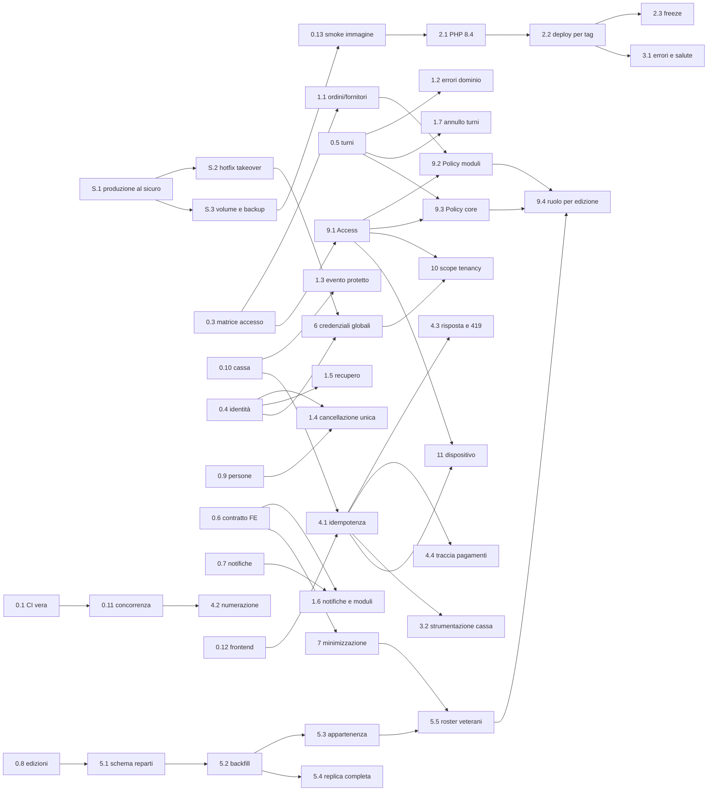

# 03 — Roadmap

> Questa roadmap traduce in step gli ADR accettati, dopo averli messi alla
> prova. Sostituisce la sezione "Ordine suggerito" di `02-sintesi.md`, che in
> alcuni punti era sbagliata (vedi §1).
>
> **Base empirica.** Ogni affermazione marcata ✅ è stata riprodotta con un
> test temporaneo, eseguito fuori dal repository, su SQLite **e** su
> PostgreSQL 16. La suite attuale (276 test) passa già su entrambi.

---

## 1. La sfida: dove "accetto tutto" sbaglia o sottovaluta un rischio

### 1.1 Un rischio che la revisione non aveva visto: presa di controllo tra associazioni ✅

Chi si registra come nuova associazione può impostare la password
dell'organizzatore di un'altra associazione, se ne conosce l'email, ed entrare
nel suo tenant. I passi sono quattro:

1. registrarsi, perché `/register` è aperto a chiunque;
2. creare nel proprio tenant una persona con l'email della vittima, cosa
   permessa perché l'unicità è controllata solo per tenant;
3. generare l'invito account: il token del broker è legato all'**email**;
4. aprire il link di reset: `Password::reset` cerca "la prima persona con
   quell'email" su **tutti** i tenant e trova la vittima.

Riprodotto su entrambi i database. L'ADR-004 stimava "ore" per la sua
raccomandazione D (indice unico parziale), ma D **non chiude** questa strada.
Il problema vale per il SaaS e anche per ogni istanza self-hosted, perché la
registrazione è aperta ovunque. È lo step **S.2**: va fatto prima di tutto il
resto.

### 1.2 "Accetto tutto" non decide quello che gli ADR lasciavano condizionale

Diverse raccomandazioni accettate contengono un'alternativa, oppure rinviano a
una risposta che non è arrivata:

- numerazione per cassa o per evento;
- sola lettura delle edizioni passate per i responsabili;
- anni di retention;
- magic link ai responsabili;
- registry dell'immagine;
- freeze dei deploy.

Senza una risposta, alcuni step non hanno criteri di completamento: un test
non può sapere se un ex responsabile deve ricevere 200 o 403. Ho quindi fissato
un **default per ognuna** (§2, decisioni D22–D42). I default sono rivedibili:
basta che mi dici quali non ti vanno. Tre punti però non posso deciderli io e
richiedono una tua azione (§10).

### 1.3 Manca la domanda che decide il perimetro: il 2027 è un pilota o il lancio?

Gli ADR dimensionano il lavoro per "centinaia di associazioni": RLS, registro
dei moduli, account globali, export automatico, Tailwind 4. Ma niente nel
codice o nei documenti indica tenant esterni reali: D19 dice "siamo in test",
non c'è fatturazione e il modello di prezzo è aperto. Se il 2027 è una
stagione pilota con poche associazioni accompagnate da te (default D22), circa
due o tre settimane di quel lavoro escono dal percorso verso maggio. Al loro
posto entra ciò che serve a una sagra vera: replica completa, cassa robusta,
strumenti per accorgersi dei guasti.

### 1.4 Le mie stime erano ottimistiche

La revisione stimava 6-8 settimane. Le verifiche le portano a circa 10-13
settimane a pieno perimetro. Alcuni esempi:

| Raccomandazione | Stima ADR | Stima rivista | Perché |
|---|---|---|---|
| Scope di tenancy (ADR-003 B) | 1-2 giorni | 4-6 giorni | Ordine dei middleware rispetto al binding, provider di autenticazione, job in coda senza contesto, `whereHas`, 10 factory che creano dati senza contesto (verificato con uno scope temporaneo che fallisce in modo chiuso) |
| RLS (ADR-003 C) | 2-4 giorni | 5-8 giorni | L'utente creato da Compose è superuser e ignora la RLS anche con `FORCE`; dopo un `RESET` il worker va in errore (verificato in psql) |
| Cassa (ADR-008 A) | 2-4 giorni | 6-9 giorni | Il token di dispositivo non entra nell'app attuale: ogni middleware e `HandleInertiaRequests` presuppongono una `Person` (verificato: `TypeError`) |
| Reparti (ADR-007) | 2-3 giorni | 4-6 giorni | Nomi duplicati nella stessa edizione, factory che chiama "Cucina" ogni area, quattro consumatori da migrare |
| Normalizzazione telefoni (ADR-004) | ore | 2-3 giorni | Il backfill collide su dati che l'app oggi accetta (verificato) e richiede uno strumento per unire le persone doppie |

Per uno sviluppatore part-time, che in stagione non ha commit (nessuno dal
5 agosto al 14 ottobre), il calendario conta più della somma: vedi §3.

### 1.5 L'ordine suggerito in 02 era sbagliato in quattro punti

1. **Accesso per dispositivo prima di Access e Policy.** L'ADR-008 stesso dice
   che dipende dall'ADR-005. La cassa va divisa: la robustezza (idempotenza,
   numerazione) subito, il dispositivo dopo Access (step 4 contro step 11).
2. **Scadenza dei ruoli prima dei reparti.** Oggi il responsabile ritrova i
   veterani dell'anno prima solo selezionando l'edizione passata (✅). Far
   scadere i ruoli prima di introdurre i reparti gli toglie l'unico modo per
   ritrovarli. I reparti vanno prima (step 5 prima di 9.4).
3. **Indici parziali prima dell'anonimizzazione unificata.** Con l'indice
   parziale si può reinserire un telefono accanto a una riga cancellata che
   conserva ancora nome ed email. Le due cose vanno nello stesso step (1.4).
4. **ADR-004 dopo ADR-003.** Lo stesso ADR-003 chiedeva il contrario. Le
   credenziali globali (step 6) vanno prima dello scope (step 10).

### 1.6 Problemi trascurati da tutta la revisione

- **Cancellare un evento cancella incassi e fatture** ✅. Le FK sono in
  cascade, quindi spariscono ordini, righe d'ordine, forniture e allegati; il
  PDF resta su disco senza riga. Il messaggio di conferma parla solo di "aree
  e turni".
- **Una migrazione già applicata potrebbe non aver fatto nulla in produzione**
  ✅. La normalizzazione delle email (`2026_07_22_000002`) cattura l'errore di
  unicità dentro la transazione. Su PostgreSQL la transazione resta abortita,
  il commit diventa un rollback e la migrazione risulta comunque eseguita. Se
  in produzione c'era anche una sola collisione di maiuscole, nessuna email è
  stata convertita, e chi ha un'email con maiuscole non riesce più a entrare
  con la password.
- **Il login non è deterministico su PostgreSQL** quando la stessa email esiste
  in più tenant ✅. Senza `ORDER BY`, la riga restituita cambia dopo un
  `UPDATE`. Su SQLite vince sempre l'id più basso, quindi i test non lo vedono.
- **Nessuna osservabilità.** Nessun error tracking, gli healthcheck di worker e
  scheduler sono disattivati, e la cassa non registra i fallimenti di rete. Le
  misure che dovrebbero decidere la cassa offline e i canali a pagamento non
  hanno strumenti, e si possono raccogliere solo in stagione.
- **La cassa ferma da due ore risponde 419** (CSRF scaduto con
  `SESSION_LIFETIME=120`) al primo "Incassa". È proprio il caso in cui il
  cassiere riprova e duplica l'ordine.
- **Un 422 è la forma sbagliata con Inertia:** apre il modale d'errore. Gli
  errori di dominio vanno trasformati in errori di validazione.
- **Fuso orario:** la sessione Postgres è in UTC, l'app in `Europe/Rome`.
  Funziona per convenzione, ma i confronti in PHP (`isPast`) sono sfasati di
  1-2 ore, e i test su Postgres dipendono dal fuso della macchina ✅.
- **La cancellazione da parte dell'organizzatore** lascia le iscrizioni future
  assegnate: il turno risulta coperto da una persona cancellata ✅.
- **Un ex responsabile** vede ancora il link d'invito attuale del tenant,
  l'elenco di tutte le persone, e può segnare pagati gli ordini dell'edizione
  corrente ✅.
- **I file in `storage/app/private` finiscono dentro l'immagine Docker**
  (`.dockerignore` non li esclude): un problema se l'immagine diventa pubblica.
- **Alcuni test con date fisse** (luglio 2026) hanno cambiato significato con
  il passare del tempo: oggi verificano turni passati invece che futuri.

### 1.7 Dove l'accettazione in blocco mette insieme cose in tensione

- **Magic link ai responsabili (ADR-004) e minimizzazione (ADR-010).**
  Accettare il primo rende ufficiale da subito un link che, se inoltrato, apre
  per un anno i telefoni dei volontari. La minimizzazione invece arriverebbe
  mesi dopo. Le due decisioni vanno legate (D26).
- **Retention (ADR-010) e appartenenza per reparto (ADR-007).** Pseudonimizzare
  dopo tre anni cancella proprio il "ha lavorato in cucina" che ADR-007 vuole
  conservare. Serve una retention a due livelli (D39).
- **Contratto `ModuleDefinition` (ADR-006) prima della replica completa.** Con
  un solo chiamante reale è generalizzazione prematura. Prima serve la replica
  completa (step 5.4); il contratto si estrae al secondo chiamante.
- **GDPR "fuori dal codice, più avanti".** `/join` raccoglie nome e telefono
  senza informativa, e la registrazione crea un titolare senza contratto
  art. 28. Per una qualunque associazione che non sia la tua, è un prerequisito
  (step 8), non un dettaglio del gruppo 5.
- **Fiscalità "prima di progettare la parte fiscale".** Il regime fiscale può
  ribaltare l'ADR-008: se serve un registratore telematico, la cassa di Fieste
  diventa un pre-conto. Il consulto va fatto ora (D32), non dopo.

---

## 2. Decisioni consolidate (D22–D42)

Le decisioni marcate **⚠ conferma** sono irreversibili o dipendono da
informazioni che ha solo il maintainer. Le altre sono default che la roadmap
usa: cambiarne uno tocca solo gli step indicati. Lo step **D** le trascrive in
`docs/dominio-e-decisioni.md`.

| # | Decisione (default) | Sostituisce / precisa | Step |
|---|---|---|---|
| D22 | **Il 2027 è una stagione pilota** con 1-5 associazioni accompagnate. Registrazione pubblica **chiusa** (flag `REGISTRATION_ENABLED`, spento di default); le associazioni entrano su invito. **⚠ conferma** | ADR-003, ADR-006, ADR-010 (perimetro) | S.2, §9 |
| D23 | **Use-case-first** al posto di API-first. Ogni mutazione con effetti collaterali o con più ingressi passa da una Action, che riceve l'attore e verifica l'autorizzazione d'ingresso. D12 (MCP in Python) sospesa. | Regola 4, D5 (parte API), D12 | 4.1, 5.4, 1.4, 9 |
| D24 | **I Turni sono un modulo di base.** Il flag per evento nasconde l'interfaccia **e** silenzia le notifiche automatiche. | D21 (parte Turni) | 1.6 |
| D25 | **Credenziali globali:** un'email associata a una password è unica su tutta l'istanza; l'anagrafica resta per tenant. Login, recupero password e reset considerano solo le righe con password. L'account globale con membership (ADR-004 C) si fa solo con un caso reale. | ADR-004 D, corretta | S.2, 6 |
| D26 | **Magic link ammesso ai responsabili** (rivede D19), legato alla minimizzazione (step 7) e al ruolo per edizione (9.4). Fino ad allora è un rischio noto, dichiarato. | D19 | 7, 9.4 |
| D27 | **Ruolo per edizione.** Dà accesso operativo finché l'edizione non è conclusa, più **30 giorni** (per le fatture che arrivano dopo la sagra). Le edizioni passate restano in **sola lettura** per chi vi ha avuto un ruolo: niente ordini, niente link d'invito, niente elenco di tutte le persone. Le Policy controllano l'evento del **record**, non quello della sessione. | ADR-005, domanda 9 | 9.4 |
| D28 | **Reparto stabile per tenant** (`departments`) per appartenenza, notifiche e replica. Ruoli e roster restano per edizione. Il roster del responsabile mostra anche i **veterani del reparto delle ultime 3 edizioni**, con i contatti mascherati. | ADR-007, domanda 10 | 5 |
| D29 | **Cassa:** numero d'ordine per evento con contatore e lock (`A-042` rinviato); idempotenza obbligatoria; cambi di pagamento tracciati; riconciliazione per cassa. **⚠ conferma** (cambia ciò che vede il cliente solo se scegli `A-042`) | ADR-008, domanda 2 | 4 |
| D30 | **Accesso per dispositivo** come attore separato: rotte proprie, non autentica mai una persona, revocabile. Ripiego 2027 se non è pronto entro il 15 aprile: un account dedicato con ruolo solo sull'area Cassa. | ADR-008 B (8b) | 11 |
| D31 | **Cassa offline** decisa a **ottobre 2027** sui dati raccolti in stagione. La strumentazione è obbligatoria prima di maggio. | ADR-008 B | 3.2, §9 |
| D32 | **Fiscalità:** consulto con un commercialista **entro novembre 2026** su tre profili (Pro Loco 398/91, APS/ETS, comitato o parrocchia). Fino ad allora nessun modello fiscale; la "chiusura di cassa" (A2) dipende dalla risposta. **⚠ azione tua** | ADR-008 | 4.4, §9 |
| D33 | **Un evento con ordini, forniture o allegati non si cancella.** | nuova | 1.3 |
| D34 | **Un solo percorso di cancellazione delle persone**, cioè l'anonimizzazione, con indici unici parziali `WHERE deleted_at IS NULL`. | ADR-010 A, ADR-004 | 1.4 |
| D35 | **Errori di dominio come errori di validazione** in italiano (redirect con errore), mai un 500 né un 422. | ADR-002 p.4, corretta | 1.2 |
| D36 | **Fuso orario:** la connessione PostgreSQL usa `UTC` in modo esplicito; gli orari dei turni sono **l'ora locale dell'evento**. È la convenzione attuale di produzione, resa esplicita e testata. | nuova | 0.1 |
| D37 | **Infrastruttura:** volume Docker per gli allegati (S3 rinviato); runtime PHP 8.4; immagine costruita in CI e pubblicata su GHCR (pubblica, amd64); deploy per tag con le migrazioni come passo separato; freeze calcolato dalle fasi di servizio dei tenant. | ADR-011 | S.3, 2 |
| D38 | **Associazioni esterne solo su una VPS in UE.** Il tunnel domestico serve solo per sviluppo e demo. | ADR-011, domanda 14 | 8 |
| D39 | **Retention a due livelli:** il dettaglio delle iscrizioni si pseudonimizza dopo **3 anni**; il fatto "ha lavorato nel reparto X" resta fino alla cancellazione. Il job gira solo in dry-run finché backup e restore non sono verificati. Si fa dopo la stagione. **⚠ conferma** (anni) | ADR-010, domanda 11 | §9 |
| D40 | **Mercato solo Italia:** `Europe/Rome`, normalizzazione dei telefoni `+39`, niente i18n del frontend. | domanda 16 | §9 |
| D41 | **Regole di scrittura del codice e dei dati:** niente `try/catch` su errori DB dentro una transazione (si usano `createOrFirst`, savepoint o `ON CONFLICT`); ogni migrazione di dati è preceduta da un comando di controllo con `--dry-run` eseguito in produzione e provata su un dump. | nuova | 4.1, 5.2, 6, §9 |
| D42 | **Open core:** non blocca nulla. Per ora: test architetturale e flag; il registro dei moduli è rinviato al secondo chiamante o alla risposta sul modello open core. | ADR-006 B, ridotta | 0.6, §9 |

---

## 3. Calendario

La stagione (maggio-settembre) è un vincolo rigido: in stagione si fanno solo
hotfix. Le misure che decidono gli investimenti del 2028 si raccolgono solo in
stagione.

| Traguardo | Data | Cosa deve essere vero |
|---|---|---|
| **T0** | entro fine ottobre 2026 | S.1-S.3 fatti: presa di controllo chiusa, registrazione chiusa, allegati e database al sicuro. Decisioni scritte (D). |
| **T1** | fine gennaio 2027 | Step 0 completo, correzioni puntuali (1), rilascio affidabile (2.1-2.2), cassa robusta (4.1-4.3), reparti e replica completa (5.1-5.4). Le associazioni replicano l'edizione tra febbraio e aprile: replica e reparti devono essere pronti prima. |
| **T2** | 15 aprile 2027 (**freeze strutturale**) | In produzione: strumentazione (3), credenziali (6), minimizzazione (7), requisiti legali (8). Traccia B fatta tutta o rimandata del tutto, mai a metà. Prova generale della cassa. |
| Stagione | maggio-settembre 2027 | Solo hotfix, con il freeze calcolato (2.3). Raccolta delle misure. |
| Dopo | da ottobre 2027 | Traccia C (§9), decisa sulle misure. |

**Capacità.** Traccia S, step D, step 0 e traccia A valgono circa 35 giorni di
lavoro; la traccia B circa 20. A due giorni a settimana, da metà ottobre a
metà aprile ci sono circa 50 giorni: la traccia A ci sta, la B solo in parte.
**Linea di taglio:** se a febbraio la traccia A non è chiusa, la traccia B
slitta a ottobre 2027 e per la cassa si usa il ripiego di D30.

---

## 4. Regole comuni a ogni step

- **Uno step = una PR**, con la suite verde su SQLite **e** PostgreSQL in CI
  (dallo step 0.1 in poi).
- **Test "bug".** Lo step 0 congela anche i comportamenti sbagliati, con test
  chiamati `test_bug_adrNNN_...`. Asseriscono lo **stato attuale** e hanno un
  docblock `@see docs/review/03-roadmap.md step X`. Lo step che corregge il bug
  **inverte** l'asserzione nello stesso commit. Un test non si cancella mai
  per far passare la CI.
- **I test P1** dell'audit di copertura non stanno nello step 0. Diventano
  precondizione dello step che tocca la loro area, nella voce "Prima del
  cambio".
- **Migrazioni:**
  - compatibili all'indietro: la versione N-1 dell'app funziona con lo schema
    N;
  - le migrazioni di dati seguono D41 (controllo `--dry-run` in produzione,
    prova su un dump);
  - mai modificare una migrazione già applicata: si scrive una migrazione
    correttiva.
- **Deploy manuale** (il cron è spento da S.1) con verifica di `/up` dopo ogni
  step. Dal 2.2 in poi si fa il deploy per tag.
- **Documentazione:** lo step aggiorna `docs/` se cambia una decisione o un
  comportamento visibile.

Formato degli step: **ADR · Dipende da · Decisione · Stima**, poi *Cosa*,
*Test*, *Completato quando*. Le stime sono in giorni di lavoro effettivo.

---

## 5. Traccia S — urgenze (prima dello step 0)

Lo step 0 è la copertura. Una vulnerabilità sfruttabile oggi però non aspetta
la copertura: l'hotfix porta con sé il proprio test di regressione, che è a sua
volta copertura.

### S.1 — Mettere al sicuro la produzione (operativo, nessun codice)

ADR-011, ADR-004 · Dipende da: — · Decisione: — · Stima: 1-2 ore

*Cosa*
- Spegnere il cron o il Task Scheduler dell'auto-deploy. Ogni merge su `main`
  ricrea il container e cancella gli allegati: d'ora in poi i deploy sono
  manuali.
- Copiare fuori dal container gli allegati
  (`docker compose cp app:/app/storage/app/private …`) e fare un `pg_dump`
  manuale su un supporto esterno.
- Eseguire in produzione queste query diagnostiche e annotare i risultati in
  una nota **privata**, fuori dal repository perché contengono dati
  personali:
  1. email presenti in più tenant
     (`SELECT email, count(DISTINCT tenant_id) … HAVING count(DISTINCT tenant_id) > 1`);
  2. email non normalizzate
     (`SELECT count(*) FROM people WHERE email <> lower(trim(email))`);
  3. token di reset creati per email che esistono anche in altri tenant
     (`password_reset_tokens` incrociata con `people`);
  4. tenant esistenti: quali non riconosci;
  5. righe di `supply_attachments` il cui file non esiste più.

*Completato quando*
- `crontab -l` (o il Task Scheduler) non contiene più il deploy;
- dump e copia dei file esistono fuori dalla macchina;
- le cinque query hanno un risultato annotato. Se la 1 o la 3 trovano casi
  reali, avvisa le persone coinvolte e reimposta le loro password.

### S.2 — Hotfix: presa di controllo tra tenant e registrazione chiusa

ADR-004, ADR-003 · Dipende da: S.1 · Decisione: D22, D25 · Stima: 0,5-1 giorno

*Prima del cambio (test rossi sul codice attuale)*
- `tests/Feature/Security/CrossTenantTakeoverTest.php`, derivato dal test di
  verifica:
  - `test_account_invite_cannot_target_an_email_of_another_tenant`;
  - `test_password_reset_never_reaches_another_tenants_person`;
  - `test_profile_email_cannot_take_an_email_with_a_password_elsewhere`.

*Cosa*
- `PersonController::accountInvite`, `PersonController::update` per chi ha una
  password e `Settings\ProfileUpdateRequest` rifiutano un'email già presente
  in un altro tenant, con il messaggio "Questa email è già usata su Fieste".
- Flag `REGISTRATION_ENABLED`, spento di default: `/register` risponde 404 e
  `Welcome.vue` nasconde il link. Throttle su `POST /register`.
- Se S.1 ha trovato email condivise, gestirle a mano prima del deploy.

*Test*
- i tre test sopra, verdi su SQLite e PostgreSQL, compresa la variante in cui
  l'esca viene cancellata (che su PostgreSQL rende la presa di controllo
  possibile);
- `RegistrationTest`: flag spento → 404; flag acceso → i test esistenti
  restano verdi.

*Completato quando* il test di presa di controllo è verde su entrambi i
motori, il deploy è in produzione e `/register` risponde 404.

*Nota.* È un hotfix: il modello completo delle credenziali arriva con lo
step 6.

### S.3 — Volume per gli allegati, backup automatici, prova di restore

ADR-011, ADR-010 · Dipende da: S.1 · Decisione: D37 · Stima: 0,5 giorni più
le operazioni

*Cosa*
- `docker-compose.yml`: volume per `storage/app` del servizio `app`.
- `.dockerignore`: escludere `storage/app/*`.
- Un servizio di backup: `pg_dump` notturno più copia dei file verso uno
  storage esterno, con rotazione di 30 giorni.
- Procedura di deploy del volume: copia fuori, deploy, copia dentro, verifica
  dei download.
- Report delle righe orfane (righe di `supply_attachments` senza file).
- `DEPLOY.md`: togliere "stateless" e documentare backup e restore.

*Test*
- `scripts/smoke/storage-persistence.sh`: un file scritto sopravvive a
  `up --force-recreate`;
- `scripts/smoke/backup-restore.sh`: dump, restore su un database di prova,
  `migrate:status` senza pending, conteggi delle righe uguali.

Per ora si eseguono a mano; dal 0.13 li esegue la CI.

*Completato quando* un allegato caricato in produzione sopravvive a una
ricreazione del container, e il restore dell'ultimo backup notturno è stato
provato davvero.

### D — Registro delle decisioni

Stima: mezza giornata · in parallelo a S

Trascrivere D22–D42 in `docs/dominio-e-decisioni.md`, marcando come superate
le parti obsolete:

- regola 4 (API-first);
- glossario "turni nel core";
- `schema-core.md` con `users`;
- D19 sui responsabili.

*Completato quando* il documento non contraddice più il codice nei punti
elencati in 01-architettura §8.3.

---

## 6. Step 0 — Copertura delle parti che verranno toccate

**Contenuto:** solo i test P0 dell'audit. I sotto-step sono **indipendenti tra
loro** e ognuno è una PR. Ogni step successivo dipende solo dai sotto-step
della sua area (§8), non da tutto lo step 0: la traccia A può partire prima che
lo step 0 sia finito.

**Criterio comune:** i test nuovi sono verdi sul codice **attuale**, su
SQLite e PostgreSQL. I bug noti sono congelati come `test_bug_…` (§4).

**Stima complessiva:** 9-10 giorni.

### 0.1 — La CI esegue davvero ciò che esiste

ADR-012 · Stima: 0,5 giorni

- `tests.yml`:
  - matrice SQLite e PostgreSQL 16 (service container);
  - `npm run test` (Vitest: 33 test, già verdi);
  - report di copertura con pcov, solo informativo;
  - togliere la creazione inutile di `database.sqlite`.
- `lint.yml`: `pint --test` e `eslint .` senza `--fix`. Passano già oggi.
- Un commit separato con `npm run format` (47 file), poi
  `prettier --check` bloccante.
- `config/database.php`: `'timezone' => 'UTC'` sulla connessione pgsql (D36).
  Nuovo test `TimezoneConventionTest`: un turno delle 19:00 si rilegge alle
  19:00 e `isPast` è coerente.

*Completato quando* un commit di prova con un test rotto, uno non formattato
e uno con un errore ESLint fa fallire la CI, su entrambi i motori.

### 0.2 — Isolamento tra tenant

ADR-003 · Stima: 1 giorno

- `tests/Feature/Tenancy/CrossTenantMatrixTest.php`: data provider di circa
  54 righe, cioè le 48 rotte con un id più 6 endpoint con l'id nel body. Un id
  di un altro tenant risponde sempre 404 e non modifica nulla.
- `ListingIsolationTest`: nessuna pagina di elenco mostra dati di un altro
  tenant. Il tenant A ha un marcatore in ogni campo; si fa la ricerca del
  marcatore nelle props delle pagine del tenant B, per ognuno dei tre ruoli.
- `CrossTenantByDesignTest`:
  - il promemoria raggiunge tutti i tenant in un solo giro;
  - una notifica in coda viene consegnata da un worker vero
    (`queue.default=database`, `queue:work --once`) senza contesto di
    richiesta.

### 0.3 — Matrice di accesso

ADR-005 · Stima: 1,5 giorni

- `tests/Feature/Authorization/AccessMatrixTest.php` e
  `ModuleAccessMatrixTest.php`.
  - Attori: organizzatore, responsabile della Cucina, responsabile del Bar,
    ex responsabile (ruolo solo in un'edizione passata), volontario,
    organizzatore di un altro tenant.
  - Assi: area propria o altrui, edizione corrente o passata.
  - Ogni riga ha lo stato **attuale** e una colonna `target` con lo step che
    la cambierà.
- Bug congelati:
  - `test_bug_adr005_past_role_still_grants_staff`;
  - `test_bug_adr005_any_staff_can_toggle_paid_on_any_order`;
  - fornitori modificabili da qualunque staff.
- Ambito della cucina per un responsabile; pagine responsabile con ruoli in
  due edizioni; contenuto del roster.

### 0.4 — Identità e accesso

ADR-004 · Stima: 1 giorno

- `ContactUniquenessTest`, sugli 8 ingressi che salvano telefono o email:
  - un duplicato nello stesso tenant viene rifiutato;
  - lo stesso contatto in un altro tenant viene accettato;
  - `test_bug_adr004_readding_a_deleted_phone_is_a_500`.
- `PhoneFormatTest`: `test_bug_adr004_same_number_in_two_formats_is_accepted_twice`.
- `GlobalCredentialsTest`:
  - `test_bug_adr004_login_depends_on_physical_order`, che su PostgreSQL
    include l'`UPDATE` che sposta la riga;
  - invito account con un'email che ha una password altrove (dopo S.2 è già
    rifiutato).
- `RecoveryTest`:
  - `test_bug_adr004_recovery_rotates_remember_token`;
  - `test_bug_adr004_recovery_is_case_sensitive`;
  - `test_organizer_regeneration_still_kills_sessions`, che deve restare
    verde dopo l'1.5.

### 0.5 — Turni e iscrizioni

ADR-002 · Stima: 1,5 giorni

- **Portare i 20 test che usano le rotte organizzatore** che verranno rimosse
  (ManageSignupsTest, OrganizationSettingsTest, SubAreaTest,
  NewShiftsNotificationTest, ManageEventsTest) **duplicandoli** sulle rotte
  `/me/...`, con due attori (organizzatore e responsabile). Gli originali
  restano finché le rotte esistono.
- `ModerationStateTest`: macchina a stati della moderazione
  (stato iniziale × stato richiesto × attore → effetti e notifiche).
- `AssignTest`: notifica una sola volta, niente notifica a sé stessi, azzera
  la sostituzione, persona cancellata → 404.
- `ShiftCreationNotificationsTest`, con date relative a `now()`.
- `ShiftDeletionTest`:
  - `test_bug_adr002_deleting_a_day_notifies_nobody`;
  - `test_bug_adr002_deleting_a_shift_notifies_nobody`.
- `DomainErrorsTest`:
  - `test_bug_adr002_domain_exception_is_a_500`: `PUT /events` con date non
    zero-padded, e replica di un giorno sull'ora legale.
- **Igiene:** sostituire le date fisse (2026-07-04, 2026-07-11) in
  `ManagerPowersTest`, `ManagerPagesTest` e `ManageEventsTest` con date
  relative o `travelTo`.

### 0.6 — Contratto con il frontend, moduli, architettura

ADR-005, ADR-006 · Stima: 0,5 giorni

- `SharedPropsTest`:
  - `auth.role` per attore, con l'ex responsabile ancora `manager` (bug);
  - forma di `auth.user`;
  - `test_bug_adr010_auth_user_leaks_tenant_invite_token`.
- `CurrentEventResolutionTest`: le regole di `resolve` e `options`.
- `tests/Feature/Architecture/ModuleRoutesTest.php`: ogni rotta di modulo ha
  `module:<chiave>`.
- `FrontendRouteNamesTest`: ogni `route('…')` usato in `resources/js` esiste.
- `CoreModuleBoundaryTest`, con le violazioni attuali in una whitelist
  esplicita (D42).
- `test_bug_adr006_reminders_ignore_the_shifts_module` e lo stesso per i
  "nuovi turni".

### 0.7 — Notifiche

ADR-009 · Stima: 1 giorno

- `ChannelsTest`: la matrice di `via()`, cioè 8 notifiche × push × email ×
  preferenze.
- `RenderingTest`: `toMail` e `toWebPush` di ogni notifica (oggi 0 righe
  coperte), con data fissa e asserzioni sulle stringhe e sugli URL;
  `test_bug_adr009_management_notifications_link_to_me`.
- `SeatFreedRecipientsTest`: turno passato, turno ancora coperto, esclusi.

### 0.8 — Appartenenza tra edizioni e ciclo di vita delle aree

ADR-007 · Stima: 0,5 giorni

- `CrossEditionMembershipTest`:
  - `test_bug_adr007_veteran_misses_new_shifts_of_the_next_edition`;
  - `…_misses_seat_freed…`;
  - `…_new_edition_area_is_not_my_area`;
  - `…_roster_forgets_last_years_volunteers`.
- `AreaLifecycleTest`: rinomina; la cancellazione a cascata di turni,
  iscrizioni e ruoli; i record di modulo restano con area `null`.
- `NewShiftsNotificationTest` con data provider sui due ingressi
  (organizzatore e responsabile).

### 0.9 — Cancellazione delle persone

ADR-010 · Stima: 0,5 giorni

- `OrganizerDeletePersonTest`:
  - `test_bug_adr010_organizer_delete_keeps_pii_and_commitments`;
  - `test_bug_adr010_the_last_organizer_can_delete_themselves_via_people`.
- `ProfileUpdateTest`: l'unico organizzatore non si cancella.
- `ErasureTest`: tutti i campi azzerati, su entrambi i percorsi esistenti.

### 0.10 — Cassa, comande, forniture

ADR-008 · Stima: 0,5 giorni

- `CassaTest::test_an_order_without_client_uuid_is_still_accepted`: deve
  restare verde anche dopo il 4.1.
- `SupplyAttachmentTest`: `Storage::fake(SupplyAttachment::DISK)` al posto di
  `'local'`; forma del percorso; file mancante → 404.
- `test_bug_d33_deleting_an_event_wipes_orders_and_orphans_invoices`.

### 0.11 — Infrastruttura per i test di concorrenza

ADR-012 · Stima: 0,5 giorni

- Gruppo `pgsql`, saltato su SQLite.
- Helper con `pcntl_fork` e `DatabaseTruncation` su un database dedicato.
- Un test di sanità: due processi inseriscono righe distinte e entrambe
  risultano visibili.
- Il test vero sulla numerazione arriva con il 4.2.

### 0.12 — Frontend

ADR-013 · Stima: 1 giorno

Esistono già prototipi verificati nello scratchpad.

- `AppSidebar.test.ts`: voci per ruolo × moduli.
- `Comande.test.ts`: polling a 15 secondi solo con la scheda visibile;
  `setStatus`.
- `Cassa.test.ts`: carrello, totale, payload di `checkout`, pulsante
  disabilitato.
- `ModeratedSignupList.test.ts`: azioni e nomi di rotta.

### 0.13 — Smoke dell'immagine in CI

ADR-011 · Dipende da: S.3 · Stima: 1 giorno

- Job `image-smoke`:
  - `docker build`;
  - `compose up --wait` con un `.env` generato;
  - `/up` risponde 200;
  - `migrate:status` senza pending;
  - gli script di S.3.
- Il controllo dei requisiti di piattaforma **non** entra qui, perché oggi
  fallirebbe: arriva con il 2.1.

---

## 7. Traccia A — prima della stagione

### 1 — Correzioni puntuali

Ognuna è una PR piccola che inverte test "bug" dello step 0.

**1.1 — Autorizzazione su ordini e fornitori** · ADR-005 · Dipende da: 0.3 ·
Stima: 0,5 giorni
- *Cosa:*
  - `PUT /orders/{id}`: lo può fare l'organizzatore oppure il responsabile
    dell'area della cassa dell'ordine. Per un ordine senza cassa basta un
    ruolo nell'evento dell'ordine.
  - Fornitori: chiunque sia staff può crearli; modificarli e cancellarli
    resta all'organizzatore.
- *Test:* si invertono le righe "bug" della matrice; il 404 si mantiene per
  gli altri tenant.
- *Completato quando* la matrice è verde con i nuovi target.

**1.2 — Errori di dominio come errori di validazione** · ADR-002 · Dipende da:
0.5 · Decisione: D35 · Stima: 1 giorno
- *Cosa:*
  - `withExceptions` trasforma un `DomainException` in un redirect `back()`
    con un errore sulla chiave `domain`, con messaggi in italiano;
  - un componente globale di errori e flash nel layout (corregge anche il
    flash `testNotificationSent`, che oggi non arriva);
  - confronto delle date in `EventController::validateEvent` fatto con
    Carbon, non sulle stringhe;
  - replica del giorno sull'ora legale senza 500.
- *Test:* si inverte `test_bug_adr002_domain_exception_is_a_500`; un test
  Vitest mostra l'errore globale.

**1.3 — Cancellazione dell'evento protetta** · D33 · Dipende da: 0.10 ·
Stima: 0,5 giorni
- *Cosa:*
  - rifiuto, con un messaggio comprensibile, se l'evento ha ordini, forniture
    o allegati;
  - migrazione: `orders.event_id` e `supplies.event_id` diventano
    `restrictOnDelete` (nessun dato da correggere);
  - un messaggio di conferma che dice cosa si cancella davvero.
- *Test:* si inverte il test bug D33; un evento vuoto resta cancellabile.

**1.4 — Un solo percorso di cancellazione delle persone e indici parziali** ·
ADR-010, ADR-004 · Dipende da: 0.4, 0.9 · Decisione: D34 · Stima: 1 giorno
- *Cosa:*
  - Action `ErasePerson`, usata da `PersonController::destroy`, da `/me/erase`
    e dalle impostazioni. Anonimizza, blocca la cancellazione dell'ultimo
    organizzatore e annuncia il posto liberato se la persona era assegnata a
    turni futuri;
  - migrazione: gli indici unici su `(tenant_id, phone)` e `(tenant_id, email)`
    diventano parziali `WHERE deleted_at IS NULL`;
  - comando `people:anonymize-trashed --dry-run` per le righe già cancellate
    che conservano dati personali. Si esegue in produzione dopo la tua
    conferma.
- *Test:* si invertono i bug di 0.9 e `…_readding_a_deleted_phone_is_a_500`;
  nuovo test sull'annuncio del posto liberato.

**1.5 — Recupero accesso** · ADR-004 · Dipende da: 0.4 · Stima: 2 ore
- *Cosa:* il recupero crea il link senza ruotare `remember_token`; l'email
  viene normalizzata prima della ricerca.
- *Test:* si invertono i due bug di `RecoveryTest`;
  `test_organizer_regeneration_still_kills_sessions` resta verde.

**1.6 — Notifiche coerenti con il modulo e con le pagine** · D24, ADR-009 ·
Dipende da: 0.6, 0.7 · Stima: 0,5 giorni
- *Cosa:*
  - promemoria e "nuovi turni" saltano gli eventi con `shifts` spento;
  - `AvailabilityReceived` e `SubstitutionRequested` linkano
    `/manage/shifts`;
  - il service worker mette a fuoco la finestra con l'URL della notifica.
- *Test:* si invertono i bug di 0.6 e 0.7.

**1.7 — Annullare turni avvisa gli assegnati** · ADR-002 · Dipende da: 0.5 ·
Stima: 0,5 giorni
- *Cosa:* nuova notifica `ShiftCancelled` per gli assegnati a turni futuri,
  sia sulla cancellazione del singolo turno sia su quella del giorno.
- *Test:* si invertono i bug di `ShiftDeletionTest`; `ChannelsTest` e
  `RenderingTest` includono la nuova notifica.

### 2 — Rilascio affidabile

**2.1 — Runtime PHP 8.4** · ADR-011 · Dipende da: 0.13 · Stima: 0,5 giorni
- *Cosa:* immagine `frankenphp:1-php8.4`; togliere
  `composer config platform-check false`; aggiungere
  `composer check-platform-reqs` allo smoke.
- *Completato quando* `image-smoke` è verde e il platform check è attivo.

**2.2 — Immagine in CI e deploy per tag** · ADR-011 · Dipende da: 2.1 ·
Decisione: D37 · Stima: 1,5 giorni
- *Cosa:*
  - un workflow pubblica `ghcr.io/…:<sha>` solo dopo test, lint e smoke
    verdi;
  - Compose usa `image:` al posto di `build:`;
  - `deploy.sh <tag>` fa: `pull`, poi `run --rm app php artisan migrate --force`
    come passo separato, poi `up -d`, poi verifica di `/up`. Se fallisce,
    rollback automatico al tag precedente;
  - `worker` e `scheduler` dipendono da `app` healthy;
  - migrazioni all'avvio spente di default;
  - `DEPLOY.md`, compreso il self-hosting senza build locale.
- *Test:* in staging o in locale, il deploy di un tag con `/up` rotto torna
  da solo al tag precedente.

**2.3 — Freeze calcolato** · ADR-011 · Dipende da: 2.2 · Stima: 0,5 giorni
- *Cosa:*
  - comando `deploy:allowed`, che fallisce se un tenant ha una fase di
    servizio tra ieri e domani;
  - `deploy.sh` lo chiama, con un `--force` documentato per gli hotfix,
    seguito da uno smoke.
- *Test:* unit test del comando, con fase di servizio sì e no.

### 3 — Osservabilità minima (prima di T2)

**3.1 — Errori e salute dei processi** · Dipende da: 2.2 · Stima: 1 giorno
- *Cosa:*
  - segnalazione delle eccezioni: una mail con throttle a un indirizzo
    tecnico, oppure GlitchTip/Sentry se lo preferisci;
  - battito dello scheduler e dei worker;
  - `/health`, protetto da token, con l'età del job più vecchio in coda,
    `failed_jobs` e l'ultimo battito;
  - un monitor esterno gratuito su `/health`;
  - rotazione dei log Docker.
- *Completato quando* un 500 provocato genera un avviso, e un worker fermo
  genera un avviso entro 10 minuti.

**3.2 — Strumentazione di cassa e cucina** · ADR-008 · Dipende da: 0.12, 4.1 ·
Decisione: D31 · Stima: 1 giorno
- *Cosa:*
  - contatore lato client di errori di rete, timeout e 419 in `Cassa.vue` e
    `Comande.vue`, conservato in `localStorage` e inviato a
    `POST /telemetry/pos` quando torna la rete;
  - log lato server;
  - indicatore "ultimo aggiornamento" sullo schermo cucina;
  - export per evento.
- *Test:* Vitest (un errore simulato incrementa il contatore e viene inviato
  al ritorno della rete); feature test dell'endpoint.

**3.3 — Portata delle notifiche** · ADR-009 · Dipende da: 0.7 · Stima: 0,5
giorni
- *Cosa:* metrica per evento: percentuale dei volontari attivi con push o
  email. È visibile all'organizzatore in Panoramica.
- *Test:* calcolo su dati di factory.

### 4 — Cassa robusta (ADR-008, parte 8a)

Dipende da: 0.10, 0.11, 0.12 · Decisione: D29.

**4.1 — Idempotenza** · Stima: 1 giorno
- *Cosa:*
  - colonna `orders.client_uuid`, nullable e unica;
  - Action `RegisterOrder` (D23);
  - la ricerca per `client_uuid` avviene **prima** della validazione;
  - creazione con `createOrFirst` (D41);
  - il frontend genera un UUID per carrello e lo conserva tra un tentativo e
    l'altro.
- *Test:*
  - stesso UUID due volte → un solo ordine, su entrambi i motori;
  - prodotto disattivato dopo il primo invio → il nuovo tentativo restituisce
    l'ordine esistente senza errore;
  - ordine senza UUID ancora accettato (0.10).

**4.2 — Numerazione sotto concorrenza** · Stima: 1 giorno
- *Cosa:* tabella `event_order_counters` (`event_id`, `last_number`) con
  `lockForUpdate`; backfill da `max(number)`.
- *Test:* `OrderNumberingConcurrencyTest` (gruppo `pgsql`, 4 processi × 25
  vendite) con **zero** fallimenti e numeri unici e contigui. Oggi la stessa
  prova fallisce dal 6 al 13% delle volte ✅.

**4.3 — Risposta leggera e sessione scaduta** · Stima: 1 giorno
- *Cosa:*
  - dopo una vendita si ricaricano solo `orders`;
  - menu delle casse caricati senza una query per cassa;
  - su un 419 si ricarica la pagina conservando carrello e UUID in
    `localStorage`, e si riprova.
- *Test:*
  - numero di query di `POST /orders` sotto una soglia (oggi 15);
  - `GET /cassa` con 10 casse con le stesse query di 1 cassa (oggi 45 contro
    27);
  - Vitest: dopo un 419 il carrello resta e il nuovo tentativo usa lo stesso
    UUID.

**4.4 — Traccia minima dei pagamenti** · Decisione: D32 · Stima: 0,5 giorni
- *Cosa:*
  - `paid_at` e `paid_by`;
  - tabella `order_payment_changes` (`order_id`, `paid`, `person_id`
    nullable, `device_id` nullable, `created_at`).

  È indipendente dal regime fiscale. La "chiusura serata" (A2) aspetta la
  risposta del commercialista (§9).
- *Test:* ogni cambio di `paid` lascia una riga con l'autore.

### 5 — Reparti stabili e replica completa (ADR-007)

Dipende da: 0.8 · Decisione: D28.

**5.1 — Schema e fixture, senza cambi di comportamento** · Stima: 0,5 giorni
- *Cosa:*
  - tabella `departments` (`tenant_id`, `name`, `family` nullable);
  - colonna `areas.department_id` nullable, con unicità
    `(event_id, department_id)` quando non è null;
  - `AreaFactory` con nomi univoci; i test che vogliono due "Cucina" lo
    dichiarano in modo esplicito.
- *Completato quando* la suite è verde e nessun comportamento è cambiato.

**5.2 — Backfill con report** · Decisione: D41 · Stima: 1 giorno
- *Cosa:*
  - comando `departments:backfill --dry-run`: nome normalizzato (trim,
    minuscole, spazi compressi) per tenant; due aree della stessa edizione
    non finiscono mai nello stesso reparto; elenca i gruppi ambigui;
  - le aree nuove ricevono il reparto alla creazione.
- *Test:* `DepartmentBackfillTest`: stesso nome in edizioni diverse → un
  reparto; stesso nome nella stessa edizione → due reparti e un avviso;
  maiuscole e spazi diversi → un reparto.
- *Completato quando* il dry-run è stato eseguito in produzione e i gruppi
  ambigui sono stati risolti.

**5.3 — Appartenenza e notifiche per reparto** · Dipende da: 5.2 · Stima: 1
giorno
- *Cosa:* `isMyArea`, `NewShiftsNotifier` e `SeatFreedNotifier` confrontano
  per `department_id`, e per `area_id` solo se il reparto manca.
- *Test:* si invertono tre dei quattro bug di `CrossEditionMembershipTest`.

**5.4 — Replica completa** · Dipende da: 5.2 · Decisione: D23 · Stima: 1,5
giorni
- *Cosa:* Action `ReplicateEdition`, che copia:
  - il reparto delle aree;
  - i sotto-reparti;
  - i turni con `sub_area_id` rimappato;
  - il listino, con area e sotto-reparto rimappati;
  - le casse con i loro menu.

  Le copie dei moduli stanno in metodi privati per modulo (il contratto
  ADR-006 resta rinviato, D42). La replica sull'ora legale non dà errori.
- *Test:* si inverte il bug della replica; l'ora legale; ordini e forniture
  non vengono mai copiati.

**5.5 — Roster con i veterani del reparto** · Dipende da: 5.3, 7 · Stima: 0,5
giorni
- *Cosa:* il roster del responsabile include i volontari del reparto delle
  ultime 3 edizioni, con i contatti mascherati (step 7).
- *Test:* si inverte `…_roster_forgets_last_years_volunteers`; i contatti
  sono mascherati.

### 6 — Credenziali globali complete (ADR-004 D, corretta)

Dipende da: S.2, 0.1, 0.4 · Decisione: D25, D41 · Stima: 1,5 giorni

*Cosa*
- comando di controllo `people:credential-conflicts --dry-run`: deve
  restituire zero;
- login, recupero password e reset con una closure
  `whereNotNull('password')`;
- unicità globale tra chi ha una password nella validazione di
  `NewPasswordController` e `ProfileUpdateRequest` (oltre a quanto fatto in
  S.2);
- indice unico parziale su `lower(email)` `WHERE password IS NOT NULL AND
  deleted_at IS NULL`;
- migrazione correttiva delle email non normalizzate, se la query 2 di S.1 ha
  trovato casi, con le collisioni gestite **prima**.

*Test*
- si inverte `test_bug_adr004_login_depends_on_physical_order`;
- login dopo un `UPDATE` del profilo con un omonimo senza password in un altro
  tenant, su PostgreSQL;
- dare una password a una seconda riga con la stessa email → errore di
  validazione, non 500.

### 7 — Minimizzazione dei dati esposti (ADR-010, punto 4)

Dipende da: 0.6 · Decisione: D26 · Stima: 1 giorno

*Cosa*
- `auth.user` con campi espliciti (`id`, `name`, `email`, e solo ciò che il
  frontend legge) e un tipo TypeScript che li descrive;
- nessun `tenant.invite_token` nelle props di chi non è organizzatore;
- telefono ed email mascherati nel roster del responsabile, con "mostra" che
  chiama un endpoint dedicato, registrato in log.

*Test*
- si inverte `test_bug_adr010_auth_user_leaks_tenant_invite_token`;
- `SharedPropsTest` sulle chiavi esatte;
- `PeopleRoster.test.ts` aggiornato.

### 8 — Requisiti per un'associazione esterna

ADR-010, ADR-011 · Dipende da: — · Decisione: D22, D38 · Stima: 1 giorno di
codice, più la parte non tecnica

*Fuori dal codice*
- modello di accordo art. 28 (DPA);
- modello di informativa che l'associazione fa propria;
- registro dei trattamenti;
- elenco dei sub-responsabili;
- produzione su una VPS in UE.

*Codice*
- link all'informativa in `/join`, nella pagina del magic link e nella
  registrazione;
- accettazione di termini e DPA all'onboarding, con versione, data e autore
  salvati sul tenant;
- font serviti in locale, al posto di `fonts.bunny.net`.

*Test*
- `/join` mostra il link all'informativa;
- un tenant non si crea senza accettazione;
- un test architetturale: nessun host esterno in `app.blade.php`.

*Completato quando* esistono i documenti e la prima associazione esterna li
ha firmati.

---

## 8. Traccia B — inverno, solo se c'è tempo prima di T2

Ogni blocco si fa **tutto** entro il 15 aprile, oppure si rimanda a ottobre
2027. Mai a metà in stagione.

### 9 — Access e Policy (ADR-005)

Decisione: D27 · Stima complessiva: 5-6 giorni

**Prima del cambio:** i test P1 dell'audit, cioè `ManagedAreasTest` e i casi
della matrice per "record di un evento non corrente", "dopo la mezzanotte
dell'ultimo giorno" e "due edizioni aperte insieme".

**9.1 — Access per richiesta, senza cambi di comportamento** · Dipende da:
0.3, 0.6 · Stima: 1 giorno
- *Cosa:*
  - `Access` come attore generico (persona, dispositivo, sistema), calcolato
    una volta per richiesta;
  - sostituisce le chiamate ripetute di `CurrentEvent::resolve` e
    `managedAreaIds`;
  - `scope()` per gli elenchi.
- *Test:*
  - una sola query su `events` per richiesta;
  - `GET /cassa` scende da 27 query;
  - la matrice resta identica.

**9.2 — Policy dei moduli** · Dipende da: 9.1, 1.1 · Stima: 1,5 giorni
- *Cosa:* Policy per Order, OrderItem, Till, Product, Supply, Supplier e
  SupplyAttachment. Controllano l'evento e l'area **del record**. Gli helper
  `authorize*` copiati vengono tolti.
- *Test:* la matrice dei moduli resta invariata.

**9.3 — Policy del core e fine del doppio percorso** · Dipende da: 9.1, 0.5 ·
Stima: 1,5 giorni
- *Cosa:*
  - Policy per Area, Shift e ShiftSignup;
  - `replicateDay` e `destroyDay` si spostano nel controller che resta;
  - poi, in un commit di pura sottrazione, si tolgono le rotte organizzatore
    `shifts.*` e `signups.*` e i metodi relativi.
- *Test:* i test duplicati in 0.5 restano verdi; si tolgono gli originali
  sulle rotte rimosse.
- *Completato quando* nessun riferimento alle rotte rimosse resta in `app/`,
  `resources/js/` e `tests/`, e replica e cancellazione del giorno funzionano
  per organizzatore e responsabile.

**9.4 — Ruolo per edizione** · Dipende da: 9.2, 9.3, 5.5 · Stima: 1 giorno
- *Cosa:*
  - staff e manager significano "ruolo in un'edizione non conclusa da più di
    30 giorni";
  - le edizioni passate in sola lettura, senza ordini, senza link d'invito e
    senza elenco di tutte le persone.
- *Test:* si invertono `test_bug_adr005_past_role_still_grants_staff` e le
  righe `target` della matrice; casi di mezzanotte e di due edizioni.

### 10 — Scope di tenancy (ADR-003 B, corretta)

Dipende da: 9.1, 0.2, 6 · Stima complessiva: 4 giorni

**Prima del cambio:** `TenantIdOnCreateTest` (P1), e un test che serializza e
deserializza ogni notifica con il contesto azzerato.

**10.1 — TenantContext** · Stima: 1,5 giorni
- *Cosa:*
  - il contesto si imposta sull'evento `Authenticated` (non con un
    middleware, che girerebbe dopo il binding) e da `Access` per il
    dispositivo;
  - hook della coda (`createPayloadUsing` più `JobProcessing`);
  - `TenantContext::bypass(fn)` per i percorsi cross-tenant per scelta.
- *Test:* una notifica in coda viene consegnata da un worker vero, senza
  richiesta.

**10.2 — Scope sui modelli di modulo** · Stima: 1 giorno
- *Cosa:*
  - scope sui modelli di Supply, Supplier, SupplyAttachment, Till, Product,
    Order e OrderItem;
  - `tenant_id` riempito alla creazione;
  - helper `TenantRule::exists` nelle loro regole di validazione.
- *Test:* matrice cross-tenant e isolamento degli elenchi verdi; senza
  contesto una query di prova fallisce in modo chiuso.

**10.3 — Scope sui modelli del core** · Stima: 1,5 giorni
- *Cosa:* scope su Event, Phase, Area, SubArea, Shift, ShiftSignup e
  PersonRole. **Non** su Person e MagicLink, che sono identità e restano
  filtrati in modo esplicito. Strategia per factory e `TestCase`.
- *Test:* come il 10.2, più tutti i percorsi da ospite (login, remember,
  reset, join, magic link, recupero).

**Condizione per riaprire la registrazione:** 10 completato, più 19 (§9).

### 11 — Accesso per dispositivo e modalità postazione (ADR-008 8b, ADR-013 B)

Dipende da: 9.1, 4.1 (e 10.1 se è stato fatto) · Decisione: D29, D30, D32 ·
Stima complessiva: 4-5 giorni

**11.1 — Abbinamento e token** · Stima: 1,5 giorni
- *Cosa:*
  - tabella `device_tokens` (hash, tenant, evento, cassa oppure area e
    sotto-reparto, `revoked_at`, `last_seen_at`);
  - link o QR di abbinamento generato da organizzatore o responsabile;
  - l'abbinamento chiude la sessione personale presente sul tablet;
  - middleware proprio sulle rotte `/pos/*`, che non autentica mai una
    persona;
  - throttle sull'abbinamento.
- *Test:*
  - un token revocato viene rifiutato;
  - un token non apre `/me`, `/manage` né `/people`;
  - un token di un altro tenant risponde 404.

**11.2 — Postazione cassa** · Stima: 1,5 giorni
- *Cosa:*
  - layout a schermo pieno sotto `/pos`;
  - `RegisterOrder` con l'attore dispositivo;
  - `orders.device_id`;
  - sessione non legata ai 120 minuti di inattività.
- *Test:* vendita da dispositivo; `created_by` null e `device_id`
  valorizzato; l'idempotenza vale anche qui.

**11.3 — Postazione cucina** · Stima: 1 giorno
- *Cosa:* schermo cucina sotto `/pos` per area o sotto-reparto, con
  indicatore "ultimo aggiornamento".
- *Test:* l'ambito del token limita le righe visibili.

**11.4 — Prova generale** · Stima: mezza giornata
- *Cosa:* simulazione con 3 dispositivi in staging, rete rallentata e
  interruzioni.
- *Completato quando* esiste una checklist firmata e nessun ordine risulta
  perso o duplicato.

**Ripiego (D30)** se il blocco 11 non è pronto entro il 15 aprile: un
account dedicato per il reparto Cassa, con ruolo solo su quell'area, e la
minimizzazione dello step 7.

### 12 — Classe base delle notifiche e ripiego manuale (ADR-009 B)

Dipende da: 0.7, 3.3 · Stima: 2 giorni

*Cosa*
- `FiesteNotification` con `via()`, formato delle date e URL comuni;
- lista "da avvisare" per chi non ha canali, con un link `wa.me`
  precompilato (prefisso `+39` aggiunto in modo euristico finché non arriva
  la normalizzazione dei telefoni).

*Test:* `ChannelsTest` e `RenderingTest` invariati; un test sulla lista.

### 13 — Igiene del frontend (ADR-013)

Dipende da: 0.12 · Stima: 2 giorni

*Cosa*
- togliere i residui dello starter kit;
- `APP_LOCALE=it` con i file di traduzione;
- Inertia `^2.0`;
- correggere il `tsconfig` e i circa 80 errori di tipo, poi
  `vue-tsc --noEmit` bloccante in CI.

*Completato quando* `vue-tsc` passa in CI.

---

## 9. Traccia C — dopo la stagione, o con una condizione esplicita

| # | Step | Condizione per iniziarlo |
|---|---|---|
| 14 | **Chiusura di cassa / riepilogo dei corrispettivi** (ADR-008 A2) | Risposta del commercialista (D32). Se la risposta dice che serve per la stagione 2027, sale nella traccia A. Se serve un registratore telematico, prima va riaperto l'ADR-008. |
| 15 | **Cassa offline** (ADR-008 B) | Le misure del 3.2 mostrano perdite o ritardi significativi |
| 16 | **Normalizzazione dei telefoni** (ADR-004), in tre step: colonna `phone_e164` e report dei duplicati; strumento per unire le persone; normalizzatore unico più indice | D40; dopo la stagione |
| 17 | **Retention** (ADR-010) a due livelli, con job in dry-run e report mensile | D39 confermata; S.3 con restore verificato; 5 fatto |
| 18 | **Export dei dati di una persona** | Prima richiesta reale, o prima del lancio SaaS |
| 19 | **Row Level Security** (ADR-003 C): ruolo applicativo non superuser, `NULLIF` nelle policy, reset per job | Prima di riaprire la registrazione a molti tenant |
| 20 | **Registro dei moduli e `ModuleDefinition`** (ADR-006 B completo) | Un secondo chiamante reale, oppure la risposta sull'open core |
| 21 | **Account globale con membership** (ADR-004 C) | Un responsabile reale in due associazioni |
| 22 | **Tailwind 4 e reka-ui** | Un periodo senza eventi e senza refactoring di dominio |
| 23 | **Canali a pagamento** (ADR-009 C) | La metrica del 3.3 mostra una portata insufficiente |
| 24 | **Riapertura della registrazione** | 10, 19, 8 e una decisione sulla fatturazione |

---

## 10. Grafo delle dipendenze

---

## 11. Cosa serve da te

Ho fissato un default per tutto, ma quattro punti li puoi chiudere solo tu.

1. **D22: quante associazioni nel 2027, e accompagnate da te?** Confermando il
   pilota, RLS, registro dei moduli, account globali ed export escono dal
   percorso verso maggio. In più: oggi in produzione ci sono tenant esterni?
   Se sì, S.2 va in produzione prima di qualsiasi altra cosa, anche questa
   settimana.
2. **D32: il consulto con il commercialista entro novembre.** È l'unica
   informazione che può ribaltare il design della cassa.
3. **D29 e D30: il modello della cassa.** Numero per evento (default) o
   `A-042`, e accesso per dispositivo con il ripiego dell'account dedicato.
4. **D39: gli anni di retention.** Non è urgente: serve solo dopo la stagione.

Per tutto il resto, dimmi solo quali default non ti vanno. Lo step D li
trascrive nelle decisioni del progetto.
