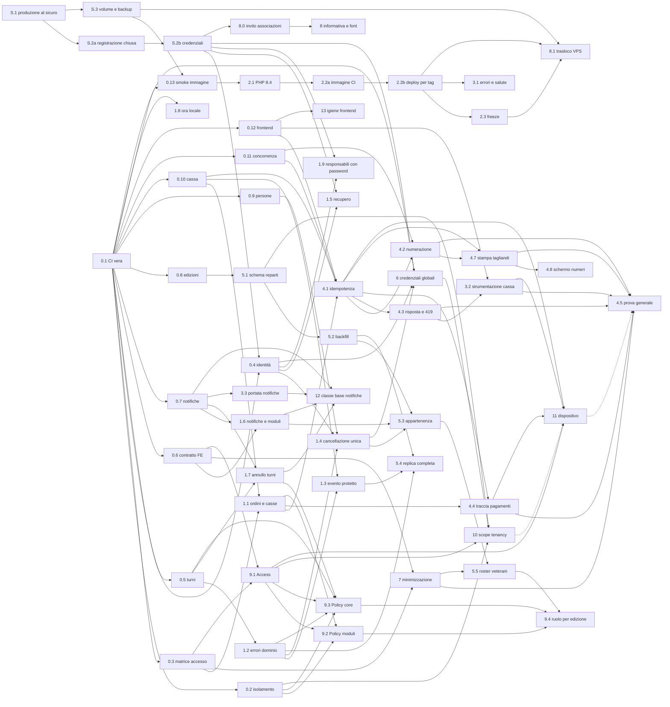

# 03 — Roadmap

> Questa roadmap traduce in step gli ADR accettati, dopo averli messi alla
> prova. Sostituisce la sezione "Ordine suggerito" di `02-sintesi.md`, che in
> alcuni punti era sbagliata (vedi §1).
>
> **Base empirica.** Ogni affermazione marcata ✅ è stata riprodotta con un
> test temporaneo, eseguito fuori dal repository, su SQLite **e** su
> PostgreSQL 16. La suite attuale (276 test) passa già su entrambi.
>
> **Revisione.** La prima stesura è stata sottoposta a una revisione
> avversariale indipendente, su tre fronti: dipendenze, verificabilità e
> correttezza tecnica. Un verificatore ha confermato 43 dei 44 rilievi gravi,
> tutti già applicati qui. Il più importante: il primo fix proposto per la
> presa di controllo (S.2b) **non bastava**.

---

## 1. La sfida: dove "accetto tutto" sbaglia o sottovaluta un rischio

### 1.1 Un rischio che la revisione non aveva visto: presa di controllo tra associazioni ✅

Chi si registra come nuova associazione può impostare la password
dell'organizzatore di un'altra associazione, se ne conosce l'email, ed entrare
nel suo tenant. I passi sono quattro:

1. registrarsi, perché `/register` è aperto a chiunque;
2. mettere l'email della vittima su una persona del proprio tenant, cosa
   permessa perché l'unicità è controllata solo per tenant. Funziona sia
   creando una persona nuova sia cambiando la propria email con
   `PUT /me/contact`;
3. generare l'invito account, anche con il body vuoto: il token del broker è
   legato all'**email**;
4. aprire il link di reset: `Password::reset` cerca "la prima persona con
   quell'email" su **tutti** i tenant e trova la vittima.

Riprodotto su entrambi i database, in tutte e due le varianti del passo 2. Ma
il problema è più largo dell'invito. Login, "password dimenticata" e reset
scelgono sempre "la prima riga con quell'email", senza ordinamento. Su
PostgreSQL l'ordine fisico cambia dopo ogni `UPDATE`. Basta quindi un omonimo
senza password in un'altra associazione perché la vittima non riesca più a
entrare, e perché la sua "password dimenticata" imposti la password sulla riga
dell'altra associazione.

L'ADR-004 stimava "ore" per la sua raccomandazione D (indice unico parziale),
ma D **non chiude** nessuna di queste strade. Il problema vale per il SaaS e
anche per ogni istanza self-hosted, perché la registrazione è aperta ovunque.
Sono gli step **S.2a** (registrazione chiusa, già fatto) e **S.2b** (credenziali, prima della seconda associazione).

### 1.2 "Accetto tutto" non decide quello che gli ADR lasciavano condizionale

Diverse raccomandazioni accettate contengono un'alternativa, oppure rinviano a
una risposta che non è arrivata:

- numerazione per cassa o per evento;
- sola lettura delle edizioni passate per i responsabili;
- anni di retention;
- magic link ai responsabili;
- registry dell'immagine;
- freeze dei deploy.

Senza una risposta, alcuni step non hanno criteri di completamento: un test
non può sapere se un ex responsabile deve ricevere 200 o 403. Ho quindi fissato
un **default per ognuna** (§2, decisioni D22–D42). I default sono rivedibili:
basta che mi dici quali non ti vanno. Quattro punti però non posso deciderli
io (§11).

### 1.3 Manca la domanda che decide il perimetro: il 2027 è un pilota o il lancio?

Gli ADR dimensionano il lavoro per "centinaia di associazioni": RLS, registro
dei moduli, account globali, export automatico, Tailwind 4. Ma niente nel
codice o nei documenti indica tenant esterni reali: D19 dice "siamo in test",
non c'è fatturazione e il modello di prezzo è aperto. Se il 2027 è una
stagione pilota con poche associazioni accompagnate da te (default D22), circa
due o tre settimane di quel lavoro escono dal percorso verso maggio. Al loro
posto entra ciò che serve a una sagra vera: replica completa, cassa robusta,
strumenti per accorgersi dei guasti.

### 1.4 Le mie stime erano ottimistiche

La revisione stimava 6-8 settimane. Le verifiche le portano a circa 10-13
settimane a pieno perimetro. Alcuni esempi:

| Raccomandazione | Stima ADR | Stima rivista | Perché |
|---|---|---|---|
| Scope di tenancy (ADR-003 B) | 1-2 giorni | 4-6 giorni | Ordine dei middleware rispetto al binding, provider di autenticazione, job in coda senza contesto, `whereHas`, 10 factory che creano dati senza contesto, rientro con il cookie remember che emette `Login` e non `Authenticated` (verificato con uno scope temporaneo che fallisce in modo chiuso) |
| RLS (ADR-003 C) | 2-4 giorni | 5-8 giorni | L'utente creato da Compose è superuser e ignora la RLS anche con `FORCE`; dopo un `RESET` il worker va in errore (verificato in psql) |
| Cassa (ADR-008 A) | 2-4 giorni | 6-9 giorni | Il token di dispositivo non entra nell'app attuale: ogni middleware e `HandleInertiaRequests` presuppongono una `Person` (verificato: `TypeError`). Idempotenza e contatore vanno coordinati, altrimenti un nuovo tentativo consuma un numero |
| Reparti (ADR-007) | 2-3 giorni | 4-6 giorni | Nomi duplicati nella stessa edizione, factory che chiama "Cucina" ogni area, quattro consumatori da migrare |
| Normalizzazione telefoni (ADR-004) | ore | 2-3 giorni | Il backfill collide su dati che l'app oggi accetta (verificato) e richiede uno strumento per unire le persone doppie |

Lo sviluppatore lavora part-time e a ondate: la storia visibile mostra
un'ondata a fine luglio e nessun commit dal 5 agosto al 14 ottobre. Per questo
il calendario conta più della somma delle stime: vedi §3.

### 1.5 L'ordine suggerito in 02 era sbagliato in quattro punti

1. **Accesso per dispositivo prima di Access e Policy.** L'ADR-008 stesso dice
   che dipende dall'ADR-005. La cassa va divisa: la robustezza (idempotenza,
   numerazione) subito, il dispositivo dopo Access (step 4 contro step 11).
2. **Scadenza dei ruoli prima dei reparti.** Oggi il responsabile ritrova i
   veterani dell'anno prima solo selezionando l'edizione passata (✅). Far
   scadere i ruoli prima di introdurre i reparti gli toglie l'unico modo per
   ritrovarli. I reparti vanno prima (step 5 prima di 9.4).
3. **Indici parziali prima dell'anonimizzazione unificata.** Con l'indice
   parziale si può reinserire un telefono accanto a una riga cancellata che
   conserva ancora nome ed email. Le due cose vanno nello stesso step (1.4).
4. **ADR-004 dopo ADR-003.** Lo stesso ADR-003 chiedeva il contrario. Le
   credenziali globali (step 6) vanno prima dello scope (step 10).

### 1.6 Problemi trascurati da tutta la revisione

- **Cancellare un evento cancella incassi e fatture** ✅. Le FK sono in
  cascade, quindi spariscono ordini, righe d'ordine, forniture e allegati; il
  PDF resta su disco senza riga. Il messaggio di conferma parla solo di "aree
  e turni".
- **Con una sola cassa gli ordini non registrano la cassa** ✅. La pagina
  nasconde il selettore e la vendita prende la cassa solo dalla sessione,
  quindi `till_id` resta vuoto. La riconciliazione per cassa sarebbe
  impossibile proprio nel caso più comune.
- **Una migrazione già applicata potrebbe non aver fatto nulla in produzione**
  ✅. La normalizzazione delle email (`2026_07_22_000002`) cattura l'errore di
  unicità dentro la transazione. Su PostgreSQL la transazione resta abortita,
  il commit diventa un rollback e la migrazione risulta comunque eseguita. Se
  in produzione c'era anche una sola collisione di maiuscole, nessuna email è
  stata convertita, e chi ha un'email con maiuscole non riesce più a entrare
  con la password.
- **"Password dimenticata" non normalizza l'email**, a differenza del login.
  Con la maiuscola iniziale messa dalla tastiera del telefono, il link non
  arriva, e la risposta neutra non lo fa capire.
- **Nessuna osservabilità.** Nessun error tracking, gli healthcheck di worker e
  scheduler sono disattivati, e la cassa non registra i fallimenti di rete. Le
  misure che dovrebbero decidere la cassa offline e i canali a pagamento non
  hanno strumenti, e si possono raccogliere solo in stagione.
- **La cassa ferma da due ore risponde 419** (CSRF scaduto con
  `SESSION_LIFETIME=120`) al primo "Incassa". È proprio il caso in cui il
  cassiere riprova e duplica l'ordine.
- **Un 422 è la forma sbagliata con Inertia:** apre il modale d'errore. Gli
  errori di dominio vanno trasformati in errori di validazione.
- **Fuso orario** ✅. La sessione Postgres è in UTC, l'app in `Europe/Rome`. Un
  turno delle 19:00 viene salvato e riletto come "19:00 UTC". Formattazione e
  confronti in SQL sono coerenti, ma `isPast()` in PHP sbaglia di 1-2 ore: lo
  usano il notifier dei posti liberati e la scadenza dei magic link.
- **La cancellazione da parte dell'organizzatore** lascia le iscrizioni future
  assegnate: il turno risulta coperto da una persona cancellata ✅.
- **Un ex responsabile** vede ancora il link d'invito attuale del tenant,
  l'elenco di tutte le persone, e può segnare pagati gli ordini dell'edizione
  corrente ✅.
- **I file in `storage/app/private` finiscono dentro l'immagine Docker**
  (`.dockerignore` non li esclude): un problema se l'immagine diventa pubblica.
- **Alcuni test con date fisse** (luglio 2026) hanno cambiato significato con
  il passare del tempo: oggi verificano turni passati invece che futuri.

### 1.7 Dove l'accettazione in blocco mette insieme cose in tensione

- **Magic link ai responsabili (ADR-004) e minimizzazione (ADR-010).**
  Accettare il primo rende ufficiale da subito un link che, se inoltrato, apre
  per un anno i telefoni dei volontari. La minimizzazione invece arriverebbe
  mesi dopo. Le due decisioni vanno legate (D26).
- **Retention (ADR-010) e appartenenza per reparto (ADR-007).** Pseudonimizzare
  dopo tre anni cancella proprio il "ha lavorato in cucina" che ADR-007 vuole
  conservare. Serve una retention a due livelli (D39).
- **Contratto `ModuleDefinition` (ADR-006) prima della replica completa.** Con
  un solo chiamante reale è generalizzazione prematura. Prima serve la replica
  completa (step 5.4); il contratto si estrae al secondo chiamante.
- **GDPR "fuori dal codice, più avanti".** `/join` raccoglie nome e telefono
  senza informativa, e la registrazione crea un titolare senza contratto
  art. 28. Per una qualunque associazione che non sia la tua, è un prerequisito
  (step 8), non un dettaglio del gruppo 5.
- **Fiscalità "prima di progettare la parte fiscale".** Il regime fiscale può
  ribaltare l'ADR-008: se serve un registratore telematico, la cassa di Fieste
  diventa un pre-conto. Il consulto va fatto ora (D32), non dopo.

---

## 2. Decisioni consolidate (D22–D42)

Le decisioni marcate **⚠ conferma** sono irreversibili o dipendono da
informazioni che ha solo il maintainer. Le altre sono default che la roadmap
usa: cambiarne uno tocca solo gli step indicati. Lo step **D** le trascrive in
`docs/dominio-e-decisioni.md`.

| # | Decisione (default) | Sostituisce / precisa | Step |
|---|---|---|---|
| D22 | **Il 2027 è una stagione pilota** con 1-5 associazioni accompagnate. Registrazione pubblica **chiusa** (flag `REGISTRATION_ENABLED`, spento di default); le associazioni entrano con un invito monouso. **✔ confermata** (16/10/2026). Oggi non ci sono associazioni esterne. | ADR-003, ADR-006, ADR-010 (perimetro) | S.2a, 8.0, 8, §9 |
| D23 | **Use-case-first** al posto di API-first. Ogni mutazione con effetti collaterali o con più ingressi passa da una Action, che riceve l'attore e verifica l'autorizzazione d'ingresso. D12 (MCP in Python) sospesa. | Regola 4, D5 (parte API), D12 | 1.4, 1.7, 4.1, 5.4, 9, 11 |
| D24 | **I Turni sono un modulo di base.** Il flag per evento nasconde l'interfaccia **e** silenzia le notifiche automatiche. | D21 (parte Turni) | 1.6 |
| D25 | **Credenziali globali.** Un'email associata a una password è unica su tutta l'istanza; l'anagrafica resta per tenant. Il **login** considera solo le righe con password, ordinate per id. **Recupero e reset preferiscono** la riga con password senza escludere le altre, perché l'invito imposta la prima password. L'**invito account** rifiuta un'email presente in qualunque altro tenant, con o senza password, finché il token resta legato all'email. **Limite noto:** un volontario presente in più associazioni con la stessa email non può ricevere un invito account (fino ad ADR-004 C). | ADR-004 D, corretta | S.2b, 6 |
| D26 | **Accesso per ruolo** (✔ confermato il 16/10/2026). **Responsabili e organizzatori** entrano con invito, completano la registrazione con una password e poi fanno login (il D19 originale; l'invito account esiste già). **I volontari** restano con il link magico. Per nominare un responsabile serve l'email; chi ha un ruolo o una password non riceve link magici. | D19 | 1.9, 7, 9.4 |
| D27 | **Ruolo per edizione.** Dà accesso operativo finché l'edizione non è conclusa, più **30 giorni** (per le fatture che arrivano dopo la sagra). Dopo, l'edizione resta in **sola lettura** per chi vi ha avuto un ruolo: Panoramica, Calendario, Volontari dell'edizione (contatti mascherati), Gestione turni senza azioni, senza elenco di tutte le persone e senza link d'invito, Forniture senza scrittura. Cassa e Comande rispondono 403. `auth.role` resta `manager`. Le Policy controllano l'evento del **record**, non quello della sessione. Tabella completa in 9.4. | ADR-005, domanda 9 | 0.3, 9.4 |
| D28 | **Reparto stabile per tenant** (`departments`) per appartenenza, notifiche e replica. Ruoli e roster restano per edizione. Il roster del responsabile mostra anche i **veterani del reparto delle ultime 3 edizioni**, con i contatti mascherati. | ADR-007, domanda 10 | 5 |
| D29 | **Cassa.** Contatore con lock e idempotenza obbligatoria; ogni ordine registra la sua cassa, e una cassa con ordini non si cancella; cambi di pagamento tracciati; riepilogo per cassa e per serata. **Numerazione e tagliandi** (dal flusso reale della sagra pilota, 16/10/2026): un **numero unico per ordine**, assegnato **solo agli ordini con piatti da preparare**, così la cucina chiama una sequenza senza buchi anche quando la cassa bevande vende; **un tagliando per ogni piatto** con il punto di ritiro stampato (oggi scritto a mano); **le bevande a tagliandino**, senza numero e senza coda, ritirate quando si vuole. Fieste stampa tutti i tagliandi (step 4.7). Caso reale: 2 casse in contemporanea, una per tutto e una per bevande e patatine. **⚠ aperto:** oggi la sagra pilota usa un sistema di cassa **a noleggio**, configurato a inizio sagra, che stampa scontrini e tagliandini e ha un display per i numeri. Va deciso se nel 2027 Fieste lo sostituisce (servono allora dispositivi, stampanti e un display propri: step 4.7 e 4.8) oppure no. | ADR-008, domanda 2 | 1.1, 4, 11 |
| D30 | **Casse nel 2027: un account dedicato** con password e ruolo solo sull'area Cassa, già collegato sui tablet (✔ confermato il 16/10/2026). Nessun terzo sistema di accesso. L'accesso per dispositivo con QR resta in traccia C. | ADR-008 B (8b) | 4.5, 11 |
| D31 | **Cassa offline** decisa a **ottobre 2027** sui dati raccolti in stagione. La strumentazione è obbligatoria prima di maggio. | ADR-008 B | 3.2, 4.5, §9 |
| D32 | **Fiscalità:** Fieste **non emette documenti fiscali**: è una cassa gestionale, che per chi deve certificare lavora affiancata a un registratore telematico o alla procedura web dell'Agenzia. Le comande sono marcate "documento non fiscale". La ricerca del 16/10/2026 (`04-fiscalita-cassa.md`) ha trovato che **le Pro Loco hanno perso il regime 398/91 dal 2026**. Consulto con un commercialista **entro novembre 2026** con le domande di quel documento. L'organizzazione pilota è una **ODV iscritta al RUNTS**: se è nel regime forfettario dell'art. 86 e resta sotto 85.000 € di proventi commerciali, secondo le fonti non deve emettere scontrini fiscali (domanda 2 del documento, da confermare). **⚠ azione tua** | ADR-008 | 4.4, §9 |
| D33 | **Un evento con ordini, forniture o allegati non si cancella.** | nuova | 1.3 |
| D34 | **Un solo percorso di cancellazione delle persone**, cioè l'anonimizzazione, con indici unici parziali `WHERE deleted_at IS NULL`. | ADR-010 A, ADR-004 | 1.4 |
| D35 | **Errori di dominio come errori di validazione** in italiano (redirect con errore), mai un 500 né un 422. | ADR-002 p.4, corretta | 1.2, 1.3, 1.4 |
| D36 | **Fuso orario.** La connessione PostgreSQL usa `UTC` in modo esplicito: è il comportamento attuale di produzione, da confermare con la query 6 di S.1. Gli orari dei turni sono **l'ora locale dell'evento**. In lettura, un cast comune reinterpreta i timestampTz come ora locale. Finché il cast non c'è, niente confronti in PHP sui timestampTz. | nuova | S.1, 0.1, 1.8 |
| D37 | **Infrastruttura:** volume Docker per gli allegati (S3 rinviato); runtime PHP 8.4; immagine costruita in CI e pubblicata su GHCR (pubblica, amd64); deploy per tag con le migrazioni come passo separato; freeze calcolato dalle fasi di servizio dei tenant. | ADR-011 | S.3, 2.1, 2.2a, 2.2b, 2.3 |
| D38 | **Associazioni esterne solo su una VPS in UE.** Il tunnel domestico serve solo per sviluppo e demo. Il trasloco conserva dominio, `APP_KEY` e chiavi VAPID. Oggi la produzione gira su un PC di casa: 8.1 è consigliato prima di maggio anche per la sola sagra del maintainer (se cadono la connessione o il PC di casa, la cassa si ferma), ed è obbligatorio prima della prima associazione esterna. | ADR-011, domanda 14 | 8.1 |
| D39 | **Conservazione fino alla richiesta di cancellazione** (scelta del maintainer, 16/10/2026): lo storico resta finché la persona non chiede di essere cancellata, e la cancellazione la anonimizza (step 1.4). In più, **chi non ha attività da 5 anni viene anonimizzato** (confermato il 16/10), con un report in dry-run prima dell'esecuzione. Si fa dopo la stagione. | ADR-010, domanda 11 | §9 |
| D40 | **Mercato solo Italia:** `Europe/Rome`, normalizzazione dei telefoni `+39`, niente i18n del frontend. | domanda 16 | §9 |
| D41 | **Regole di scrittura del codice e dei dati:** niente `try/catch` su errori DB dentro una transazione (si usano `createOrFirst`, savepoint o `ON CONFLICT`); ogni migrazione di dati è preceduta da un comando di controllo con `--dry-run` eseguito in produzione e provata su un dump. | nuova | 1.4, 4.1, 5.2, 6, §9 |
| D42 | **Open core:** non blocca nulla. Per ora: test architetturale e flag; il registro dei moduli è rinviato al secondo chiamante o alla risposta sul modello open core. | ADR-006 B, ridotta | 0.6, 5.4, §9 |

---

## 3. Calendario

La stagione (maggio-settembre) è un vincolo rigido: in stagione si fanno solo
hotfix. Le misure che decidono gli investimenti del 2028 si raccolgono solo in
stagione.

| Traguardo | Data | Cosa deve essere vero |
|---|---|---|
| **T0** | entro fine ottobre 2026 | S.1, S.2a e S.3 fatti: registrazione chiusa (✔), allegati e database al sicuro. Decisioni scritte (D). |
| **T1** | fine gennaio 2027 | Credenziali tra associazioni (S.2b); step 0 completo; correzioni puntuali (1.1-1.8); rilascio affidabile (2.1, 2.2a, 2.2b); cassa robusta (4.1-4.4); reparti e replica completa (5.1-5.4); ingresso su invito (8.0). Le associazioni replicano l'edizione tra febbraio e aprile: replica e reparti devono essere pronti prima. |
| **T2** | 15 aprile 2027 (**freeze strutturale**) | In produzione: strumentazione (3), freeze calcolato (2.3), credenziali (6), minimizzazione (7), roster dei veterani (5.5), requisiti legali (8) ed eventuale trasloco (8.1). Stampa dei tagliandi (4.7), prova generale della cassa (4.5) e rendiconto per evento (4.6). Ogni blocco della traccia B si fa tutto o si rimanda tutto (§8). |
| Stagione | maggio-settembre 2027 | Solo hotfix, con il freeze calcolato (2.3). Raccolta delle misure. |
| Dopo | da ottobre 2027 | Traccia C (§9), decisa sulle misure. |

**Capacità.** Traccia S, step D, step 0 e traccia A valgono circa 43 giorni di
lavoro (compresa la stampa dei tagliandi); la traccia B circa 20. A due giorni a settimana, da metà ottobre a
metà aprile ci sono circa 50 giorni: la traccia A ci sta, la B solo in parte.

**Linea di taglio.** Se a fine febbraio T1 non è chiuso, la traccia B slitta a
ottobre 2027 e per la cassa si usa il ripiego di D30. In ogni caso gli step
della traccia A previsti per T2 hanno la precedenza sui blocchi B.

---

## 4. Regole comuni a ogni step

- **Uno step = una PR**, con la suite verde su SQLite **e** PostgreSQL in CI.
  Prima dello step 0.1 (che porta PostgreSQL in CI), la variante PostgreSQL si
  esegue in locale e l'output va nella descrizione della PR.
- **Test "bug".**
  - Lo step 0 congela anche i comportamenti sbagliati, con test chiamati
    `test_bug_…`. Asseriscono lo **stato attuale** e hanno un docblock
    `@see docs/review/03-roadmap.md step X`.
  - Lo step che corregge il bug **inverte** l'asserzione nello stesso commit.
    Un test non si cancella mai per far passare la CI.
  - Un test bug che asserisce un 500 causato da una violazione di vincolo fa
    **una sola** richiesta che fallisce, come ultima azione, senza asserzioni
    sul database dopo: su PostgreSQL la transazione del test resta abortita. Lo
    stato del database si verifica nel test invertito.
- **I test P1** dell'audit di copertura non stanno nello step 0, salvo quelli
  elencati nella sua intestazione. Diventano precondizione dello step che tocca
  la loro area, nella voce "Prima del cambio".
- **Migrazioni:**
  - compatibili all'indietro: la versione N-1 dell'app funziona con lo schema
    N, e la versione N tollera le scritture fatte dalla N-1 dopo la
    migrazione (finestra di deploy del 2.2b e rollback automatico);
  - le migrazioni di dati seguono D41 (controllo `--dry-run` in produzione,
    prova su un dump);
  - mai modificare una migrazione già applicata: si scrive una migrazione
    correttiva.
- **Deploy manuale** (il cron è spento da S.1) con verifica di `/up` dopo ogni
  step. Finché il volume di S.3 non è in produzione, ogni deploy copia fuori e
  poi ricopia `storage/app/private`. Dal 2.2b in poi si fa il deploy per tag.
- **Completato quando.** Se uno step non lo dice in modo esplicito, vale il
  default: test elencati verdi su SQLite e PostgreSQL in CI, test bug citati
  invertiti nello stesso commit, deploy fatto e `/up` verificato.
- **Documentazione:** lo step aggiorna `docs/` se cambia una decisione o un
  comportamento visibile.

Formato degli step: **ADR · Dipende da · Decisione · Stima**, poi *Cosa*,
*Test*, *Completato quando*. Le stime sono in giorni di lavoro effettivo.

---

## 5. Traccia S — urgenze (prima dello step 0)

Lo step 0 è la copertura. Una vulnerabilità sfruttabile oggi però non aspetta
la copertura: l'hotfix porta con sé i propri test di regressione, che sono a
loro volta copertura.

### S.1 — Mettere al sicuro la produzione (operativo, nessun codice)

ADR-011, ADR-004 · Dipende da: — · Decisione: — · Stima: 1-2 ore

*Cosa*
- Spegnere il cron o il Task Scheduler dell'auto-deploy. Ogni merge su `main`
  ricrea il container e cancella gli allegati: d'ora in poi i deploy sono
  manuali.
- Copiare fuori dal container gli allegati
  (`docker compose cp app:/app/storage/app/private …`) e fare un `pg_dump`
  manuale su un supporto esterno.
- Eseguire in produzione queste query diagnostiche e annotare i risultati in
  una nota **privata**, fuori dal repository perché contengono dati
  personali:
  1. email presenti in più tenant
     (`SELECT email, count(DISTINCT tenant_id) … HAVING count(DISTINCT tenant_id) > 1`);
  2. email non normalizzate
     (`SELECT count(*) FROM people WHERE email <> lower(trim(email))`);
  3. token di reset creati per email che esistono anche in altri tenant
     (`password_reset_tokens` incrociata con `people`);
  4. tenant esistenti: quali non riconosci;
  5. righe di `supply_attachments` il cui file non esiste più;
  6. fuso della sessione vista dall'app:
     `docker compose exec app php artisan tinker --execute="dump(DB::selectOne('show timezone'))"`.

*Completato quando*
- `crontab -l` (o il Task Scheduler) non contiene più il deploy;
- dump e copia dei file esistono fuori dalla macchina;
- le sei query hanno un risultato annotato. Se la 1 o la 3 trovano casi reali,
  avvisa le persone coinvolte e reimposta le loro password. Se la 6 non dà
  `UTC`, lo step 0.1 non imposta UTC e serve prima una migrazione dei dati
  (D41).

### S.2a — Registrazione chiusa ✔ fatto (16/10/2026)

La registrazione di nuove associazioni è chiusa appena ne esiste una; un
`REGISTRATION_ENABLED=true` la riapre. Un'installazione nuova, senza
associazioni, resta aperta per il primo organizzatore. Le pagine nascondono il
link. Il `POST /register` ha un throttle. Test: `RegistrationTest` (4 test
nuovi, che falliscono sul codice precedente). Con una sola associazione in
produzione, questo basta a chiudere la presa di controllo di §1.1, perché
nessuno può creare la seconda.

### S.2b — Credenziali tra associazioni (prima della seconda associazione)

Va fatto **prima di 8.0**, cioè prima di far entrare la seconda associazione
del pilota. Fino ad allora S.2a basta.

ADR-004, ADR-003 · Dipende da: S.2a · Decisione: D22, D25 · Stima: 1 giorno

*Prima del cambio (test rossi sul codice attuale)*

Nel file `tests/Feature/Security/CrossTenantTakeoverTest.php`, derivato dal
test di verifica:

- `test_account_invite_without_body_checks_the_stored_email`: esca creata con
  `POST /people`, invito senza email nel body (il percorso del test di
  verifica);
- `test_me_contact_then_account_invite_cannot_take_over_another_tenant`;
- `test_password_reset_never_reaches_another_tenants_person`;
- `test_a_passwordless_namesake_elsewhere_never_blocks_login`: omonimo creato
  sia con `POST /people` sia con `/join` più `PUT /me/contact`;
- `test_forgot_password_reaches_the_row_with_a_password`.

Su PostgreSQL gli ultimi tre fanno prima un `UPDATE` della riga della vittima,
per portare l'omonimo in testa all'heap.

*Cosa*
- **Invito account.** `PersonController::accountInvite` controlla l'email
  **effettiva** (`$data['email'] ?? $person->email`, quindi anche quella già
  salvata quando il body è vuoto) contro **qualunque** riga non cancellata di
  un altro tenant, con o senza password. Errore di validazione: "Questa email
  è già usata su Fieste". Il controllo dell'invito non va mai ristretto alle
  righe con password: riaprirebbe la presa di controllo dei responsabili senza
  password (D26).
- **Profilo e anagrafica.** `PersonController::update`,
  `Settings\ProfileUpdateRequest` e `Volunteer\ProfileController::updateContact`
  (`PUT /me/contact`), quando la persona modificata ha una password,
  rifiutano un'email che in un altro tenant appartiene a una riga con
  password. Il controllo scatta solo se l'email **cambia**, così chi ha un
  omonimo senza password altrove può continuare a modificare il proprio nome.
- **Login.** Credenziali con closure
  `fn ($q) => $q->whereNotNull('password')->orderBy('id')`.
- **Password dimenticata e reset.** Closure che **preferisce** la riga con
  password senza escludere le altre
  (`orderByRaw('case when password is null then 1 else 0 end')->orderBy('id')`),
  così l'invito a chi non ha ancora una password continua a funzionare.
- Se S.1 ha trovato email condivise, gestirle a mano prima del deploy.

*Test*
- i cinque test sopra, verdi su SQLite e PostgreSQL;
- `test_editing_with_unchanged_email_works_when_a_namesake_exists_elsewhere`;
- `test_invite_is_refused_when_a_passwordless_namesake_exists_elsewhere`, che
  documenta il limite noto di D25;
- `ManagePeopleTest::test_the_invited_person_can_set_a_password_and_log_in`
  resta verde;

*Completato quando*
- i test sono verdi su entrambi i motori;
- il deploy è in produzione;
- se S.3 non è ancora in produzione, il deploy segue la procedura di S.3: si
  copia fuori `storage/app/private` prima dell'`up`, poi la si ricopia dentro
  e si verifica il download di un allegato.

*Nota.* Restano allo step 6 l'indice parziale, la validazione globale
completa e il comando di controllo.

### S.3 — Volume per gli allegati, backup automatici, prova di restore

ADR-011, ADR-010 · Dipende da: S.1 · Decisione: D37 · Stima: 0,5 giorni più
le operazioni

*Cosa*
- `docker-compose.yml`: volume per `storage/app` del servizio `app`.
- `.dockerignore`: escludere `storage/app/*`.
- Un servizio di backup: `pg_dump` notturno più copia dei file verso uno
  storage esterno, con rotazione di 30 giorni.
- Procedura di deploy del volume: copia fuori, deploy, copia dentro, verifica
  dei download.
- Report delle righe orfane (righe di `supply_attachments` senza file).
- `DEPLOY.md`: togliere "stateless" e documentare backup e restore.

*Test*
- `scripts/smoke/storage-persistence.sh`: un file scritto sopravvive a
  `up --force-recreate`;
- `scripts/smoke/backup-restore.sh`: dump, restore su un database di prova,
  `migrate:status` senza pending, conteggi delle righe uguali.

Per ora si eseguono a mano; dal 0.13 li esegue la CI.

*Completato quando* un allegato caricato in produzione sopravvive a una
ricreazione del container, e il restore dell'ultimo backup notturno è stato
provato davvero.

### D — Registro delle decisioni

Stima: mezza giornata · in parallelo a S

Trascrivere D22–D42 in `docs/dominio-e-decisioni.md`, marcando come superate
le parti obsolete:

- regola 4 (API-first);
- glossario "turni nel core";
- `schema-core.md` con `users`;
- D19 sui responsabili.

*Completato quando* il documento non contraddice più il codice nei punti
elencati in 01-architettura §8.3.

---

## 6. Step 0 — Copertura delle parti che verranno toccate

**Ordine.** **0.1 va per primo:** porta PostgreSQL e Vitest in CI e il fuso
D36. Senza, il criterio comune non è verificabile in CI e i test di data su
PostgreSQL dipendono dal fuso della macchina. Gli altri sotto-step dipendono
solo da 0.1 e sono indipendenti tra loro; 0.13 dipende anche da S.3. Ogni
sotto-step è una PR. Ogni step successivo dipende solo dai sotto-step della sua
area (§10), non da tutto lo step 0: la traccia A può partire prima che lo
step 0 sia finito.

**Contenuto.** I test P0 dell'audit, più alcuni P1 promossi perché uno step
della traccia A tocca subito quel codice:

- i test di rendering delle notifiche (0.7);
- i test frontend di `AppSidebar`, `Cassa` e `Comande` (0.12);
- i test sugli allegati (0.10).

**Criterio comune.** I test nuovi sono verdi sul codice **attuale**, su
SQLite e PostgreSQL. I bug noti sono congelati come `test_bug_…` (§4).

**Stima complessiva:** circa 11 giorni.

### 0.1 — La CI esegue davvero ciò che esiste

ADR-012 · Decisione: D36 · Stima: 0,5 giorni

- `tests.yml`:
  - matrice SQLite e PostgreSQL 16 (service container);
  - `npm run test` (Vitest: 33 test, già verdi);
  - report di copertura con pcov, solo informativo;
  - togliere la creazione inutile di `database.sqlite`.
- `lint.yml`: `pint --test` e `eslint .` senza `--fix`. Passano già oggi.
- Un commit separato con `npm run format` (47 file), poi
  `prettier --check` bloccante.
- `config/database.php`: `'timezone' => 'UTC'` sulla connessione pgsql (D36),
  a condizione che la query 6 di S.1 abbia dato `UTC`. È un cambio di
  configurazione, ma non cambia nulla in produzione; rende deterministici i
  test su PostgreSQL.
- `TimezoneConventionTest`: su entrambi i motori un turno delle 19:00 si
  rilegge con `format('H:i') === '19:00'`, e il confronto in SQL con `now()`
  è coerente.
- `test_bug_d36_is_past_is_shifted_on_pgsql`: alle 20:00 un turno delle 19:00
  dà `isPast() = false` su PostgreSQL e `true` su SQLite (`@see` step 1.8).

*Completato quando* un commit di prova con un test rotto, uno non formattato
e uno con un errore ESLint fa fallire la CI, su entrambi i motori.

### 0.2 — Isolamento tra tenant

ADR-003 · Dipende da: 0.1 · Stima: 1 giorno

- `tests/Feature/Tenancy/CrossTenantMatrixTest.php`, con data provider sulle
  48 rotte con un id e sui 6 endpoint con l'id nel body:
  - organizzatore del tenant B → `assertNotFound` sulle 48 rotte;
  - responsabile del tenant B → status in [403, 404] (lo scope del 10 può
    spostare un 403 a 404);
  - id nel body → `assertSessionHasErrors(<campo atteso>)`;
  - `POST /current-event` → 403;
  - in tutti i casi lo snapshot del tenant A (conteggi di tutte le tabelle e
    campi chiave come stato delle iscrizioni, `paid`, nomi, numero di magic
    link) è identico prima e dopo.
- `ListingIsolationTest`: nessuna pagina di elenco mostra dati di un altro
  tenant. Il tenant A ha un marcatore in ogni campo; si cerca il marcatore
  nelle props delle pagine del tenant B, per ognuno dei tre ruoli.
- `CrossTenantByDesignTest`:
  - il promemoria raggiunge tutti i tenant in un solo giro;
  - una notifica in coda viene consegnata da `queue:work --once`
    (`queue.default=database`) dopo aver azzerato lo stato della richiesta
    (`app('auth')->forgetGuards()`, `app()->forgetScopedInstances()`,
    `Facade::clearResolvedInstances()`). Subito prima si asserisce
    `auth()->guest()`.

### 0.3 — Matrice di accesso

ADR-005 · Dipende da: 0.1 · Decisione: D27 · Stima: 1,5 giorni

- `tests/Feature/Authorization/AccessMatrixTest.php` e
  `ModuleAccessMatrixTest.php`.
  - Attori: organizzatore, responsabile della Cucina, responsabile del Bar,
    ex responsabile (ruolo solo in un'edizione passata), volontario,
    organizzatore di un altro tenant.
  - Assi: area propria o altrui, edizione corrente o passata.
  - Ogni riga ha lo **status attuale** e una colonna `target` con lo status
    atteso e lo step che lo cambierà (tabella di 9.4 per l'ex responsabile).
- Bug congelati, con un test per riga, così ogni riga si inverte da sola:
  - `test_bug_adr005_past_role_…` (una riga per ogni rotta della tabella di
    9.4);
  - `test_bug_adr005_any_staff_can_toggle_paid_on_any_order`;
  - fornitori modificabili da qualunque staff.
- Ambito della cucina per un responsabile; pagine responsabile con ruoli in
  due edizioni; contenuto del roster.

### 0.4 — Identità e accesso

ADR-004 · Dipende da: 0.1 · Stima: 1 giorno

- `ContactUniquenessTest`, sugli 8 ingressi che salvano telefono o email:
  - un duplicato nello stesso tenant viene rifiutato;
  - lo stesso contatto in un altro tenant viene accettato negli ingressi che
    non danno una password: `store`, join, `ManagerPeople`, `AreaManager`,
    `assign`, `/me/contact` e `update` di chi non ha password;
  - per l'invito account, per settings/profile e per l'`update` o
    `/me/contact` di chi ha una password, oggi l'email presente altrove viene
    accettata: le righe con il rifiuto le aggiunge S.2b;
  - `test_bug_adr004_readding_a_deleted_phone_is_a_500` (§4: ultima azione del
    test).
- `PhoneFormatTest`:
  - `test_bug_adr004_same_number_in_two_formats_is_accepted_twice`;
  - `test_recovery_matches_common_italian_formats` e
    `test_short_contacts_match_nobody`, che servono a 10.3 e 16.
- `RecoveryTest`:
  - `test_bug_adr004_recovery_rotates_remember_token`;
  - `test_bug_adr004_recovery_is_case_sensitive`;
  - `test_bug_adr004_forgot_password_is_case_sensitive`;
  - `test_organizer_regeneration_still_kills_sessions`, che deve restare
    verde dopo l'1.5.

### 0.5 — Turni e iscrizioni

ADR-002 · Dipende da: 0.1 · Stima: 1,5 giorni

- **Portare i 20 test che usano le rotte organizzatore** che verranno rimosse
  (ManageSignupsTest, OrganizationSettingsTest, SubAreaTest,
  NewShiftsNotificationTest, ManageEventsTest), **duplicandoli** sulle rotte
  `/me/...` con due attori (organizzatore e responsabile).
  - Gli originali restano finché le rotte esistono.
  - Ogni duplicato ha un docblock `@see <Test originale>::<metodo>`.
  - In `NewShiftsNotificationTest` la duplicazione si fa con un data provider
    sui due ingressi.
- `ModerationStateTest`: macchina a stati della moderazione
  (stato iniziale × stato richiesto × attore → effetti e notifiche).
- `AssignTest`: notifica una sola volta, niente notifica a sé stessi, azzera
  la sostituzione, persona cancellata → 404.
- `ShiftCreationNotificationsTest`, con date relative a `now()`.
- `ShiftDeletionTest`:
  - `test_bug_adr002_deleting_a_day_notifies_nobody`;
  - `test_bug_adr002_deleting_a_shift_notifies_nobody`, su
    `DELETE /me/shifts/{shift}`, il percorso usato dall'interfaccia;
  - `test_deleting_a_past_day_never_notifies`, verde oggi e dopo l'1.7.
- `DomainErrorsTest`:
  - `test_bug_adr002_domain_exception_is_a_500`: `PUT /events` con date non
    zero-padded;
  - `test_bug_adr002_replicating_a_day_onto_the_dst_day_is_a_500`;
  - `test_bug_adr002_replicating_an_edition_onto_the_dst_day_is_a_500`
    (ultima azione del test; nessun evento nuovo).
- **Igiene:** sostituire le date fisse (2026-07-04, 2026-07-11) in
  `ManagerPowersTest`, `ManagerPagesTest` e `ManageEventsTest` con date
  relative o `travelTo`.

*Completato quando* la PR contiene la checklist dei 20 metodi originali,
ognuno con il suo duplicato verde.

### 0.6 — Contratto con il frontend, moduli, architettura

ADR-005, ADR-006 · Dipende da: 0.1 · Stima: 0,5 giorni

- `SharedPropsTest`:
  - `auth.role` per attore. L'ex responsabile resta `manager`, una
    caratterizzazione confermata da D27;
  - forma di `auth.user`;
  - `test_bug_adr010_auth_user_leaks_tenant_invite_token`.
- `CurrentEventResolutionTest`: le regole di `resolve` e `options`.
- `tests/Feature/Architecture/ModuleRoutesTest.php`: ogni rotta di modulo ha
  `module:<chiave>`.
- `FrontendRouteNamesTest`: ogni `route('…')` usato in `resources/js` esiste.
- `CoreModuleBoundaryTest`, con le violazioni attuali in una whitelist
  esplicita (D42).
- `test_bug_adr006_reminders_ignore_the_shifts_module` e lo stesso per i
  "nuovi turni".

### 0.7 — Notifiche

ADR-009 · Dipende da: 0.1 · Stima: 1 giorno

- `ChannelsTest`: la matrice di `via()`, cioè 8 notifiche × push × email ×
  preferenze.
- `RenderingTest`:
  - `toMail` e `toWebPush` di ogni notifica (oggi 0 righe coperte), con data
    fissa e asserzioni sulle stringhe e sugli URL;
  - `test_bug_adr009_management_notifications_link_to_me`.
- `SeatFreedRecipientsTest`: turno passato, turno ancora coperto, esclusi.
- `public/sw.test.ts`:
  `test_bug_adr009_notification_click_focuses_me_regardless_of_url`.

### 0.8 — Appartenenza tra edizioni e ciclo di vita delle aree

ADR-007 · Dipende da: 0.1 · Stima: 0,5 giorni

- `CrossEditionMembershipTest`:
  - `test_bug_adr007_veteran_misses_new_shifts_of_the_next_edition`;
  - `…_misses_seat_freed…`;
  - `…_new_edition_area_is_not_my_area`;
  - `…_roster_forgets_last_years_volunteers`.
- `AreaLifecycleTest`: rinomina; la cancellazione a cascata di turni,
  iscrizioni e ruoli; i record di modulo restano con area `null`.

### 0.9 — Cancellazione delle persone

ADR-010 · Dipende da: 0.1 · Stima: 0,5 giorni

- `OrganizerDeletePersonTest`:
  - `test_bug_adr010_organizer_delete_keeps_pii_and_commitments`;
  - `test_bug_adr010_the_last_organizer_can_delete_themselves_via_people`.
- `ProfileUpdateTest`: l'unico organizzatore non si cancella.
- `ErasureTest`: tutti i campi azzerati, su entrambi i percorsi esistenti.

### 0.10 — Cassa, comande, forniture

ADR-008 · Dipende da: 0.1 · Stima: 0,5 giorni

- `CassaTest`:
  - `test_an_order_without_client_uuid_is_still_accepted`, che deve restare
    verde anche dopo il 4.1;
  - `test_bug_adr008_single_till_orders_have_no_till`.
- `SupplyAttachmentTest`: `Storage::fake(SupplyAttachment::DISK)` al posto di
  `'local'` (allinea il test al codice, non cambia il comportamento); forma
  del percorso; file mancante → 404.
- `test_bug_d33_deleting_an_event_wipes_orders_and_orphans_invoices`.

### 0.11 — Infrastruttura per i test di concorrenza

ADR-012 · Dipende da: 0.1 · Stima: 0,5 giorni

- Gruppo `pgsql`, escluso dalla run principale in `phpunit.xml` ed eseguito
  in un passo CI separato, dopo la suite principale:
  `DB_DATABASE=sagra_race vendor/bin/phpunit --group pgsql`.
- `DatabaseTruncation` solo in quell'invocazione. Nella stessa run della
  suite principale non migrerebbe il database, perché `RefreshDatabase` ha già
  segnato lo schema come migrato.
- Prima del fork `DB::disconnect()`; nei figli `DB::purge()`. I figli fanno
  solo richieste HTTP su dati creati dal padre, oppure inseriscono valori
  espliciti. Se un figlio usa le factory, serve `mt_srand(getmypid())` e
  `fake()->seed(getmypid())`.
- Test di sanità: due figli inseriscono righe con valori espliciti e il padre
  ne vede due.

*Completato quando* il passo separato è verde in CI e la run principale non
esegue il gruppo.

### 0.12 — Frontend

ADR-013 · Dipende da: 0.1 · Stima: 1 giorno

Esistono già prototipi verificati nello scratchpad.

- `AppSidebar.test.ts`: voci per ruolo × moduli.
- `Comande.test.ts`: polling a 15 secondi solo con la scheda visibile;
  `setStatus`.
- `Cassa.test.ts`: carrello, totale, payload di `checkout`, pulsante
  disabilitato.

### 0.13 — Smoke dell'immagine in CI

ADR-011 · Dipende da: 0.1, S.3 · Stima: 1 giorno

- Job `image-smoke`:
  - `docker build`;
  - `compose up --wait` con un `.env` generato;
  - `/up` risponde 200;
  - `migrate:status` senza pending;
  - gli script di S.3.
- Il controllo dei requisiti di piattaforma **non** entra qui, perché oggi
  fallirebbe: arriva con il 2.1.

---

## 7. Traccia A — prima della stagione

### 1 — Correzioni puntuali

Ognuna è una PR piccola che inverte test "bug" dello step 0.

**1.1 — Autorizzazione su ordini e fornitori, cassa registrata** · ADR-005,
ADR-008 · Dipende da: 0.3, 0.10 · Decisione: D29 · Stima: 1 giorno
- *Cosa:*
  - `OrderController::store` risolve la cassa come fa `index`: dalla
    sessione, altrimenti la prima cassa dell'evento. Così con una sola cassa
    l'ordine registra `till_id`;
  - una cassa con ordini non si cancella: `orders.till_id` passa a
    `restrictOnDelete`, con un messaggio comprensibile;
  - `PUT /orders/{id}`:
    - ordine con una cassa che ha un'area: lo possono fare l'organizzatore o
      il responsabile di quell'area;
    - cassa senza area: solo l'organizzatore;
    - ordine senza cassa (evento senza casse, o dati storici): basta un ruolo
      nell'evento dell'ordine;
  - fornitori: chiunque sia staff può crearli; modificarli e cancellarli
    resta all'organizzatore.
- *Test:*
  - si invertono le righe "bug" della matrice e
    `test_bug_adr008_single_till_orders_have_no_till`;
  - nuove righe: "cassa senza area", "cassa con ordini non cancellabile";
  - il 404 si mantiene per gli altri tenant.

**1.2 — Errori di dominio come errori di validazione** · ADR-002 · Dipende da:
0.5 · Decisione: D35 · Stima: 1 giorno
- *Cosa:*
  - `withExceptions` trasforma un `DomainException` in un redirect `back()`
    con un errore sulla chiave `domain`, con messaggi in italiano;
  - un componente globale di errori e flash nel layout (corregge anche il
    flash `testNotificationSent`, che oggi non arriva);
  - confronto delle date in `EventController::validateEvent` fatto con
    Carbon, non sulle stringhe;
  - un unico helper per spostare i turni di N giorni, usato da `replicateDay`
    (e poi da 5.4). La replica del giorno e dell'edizione sull'ora legale
    diventa un errore di dominio: nessun 500 e nessun evento creato.
- *Test:* si invertono i tre test bug di `DomainErrorsTest`; un test Vitest
  mostra l'errore globale.

**1.3 — Cancellazione dell'evento protetta** · D33 · Dipende da: 0.10, 1.2 ·
Decisione: D33, D35 · Stima: 0,5 giorni
- *Cosa:*
  - rifiuto con un errore di validazione se l'evento ha ordini, forniture o
    allegati;
  - migrazione: `orders.event_id` e `supplies.event_id` diventano
    `restrictOnDelete` (nessun dato da correggere);
  - un messaggio di conferma che dice cosa si cancella davvero.
- *Test:* si inverte il test bug D33; un evento vuoto resta cancellabile.

**1.4 — Un solo percorso di cancellazione delle persone e indici parziali** ·
ADR-010, ADR-004 · Dipende da: 0.4, 0.9, 1.2 · Decisione: D23, D34, D35, D41 ·
Stima: 1 giorno
- *Prima del cambio:*
  - `ErasureSideEffectsTest::test_bug_adr010_self_erasure_frees_the_seat_silently`;
  - `test_past_history_still_counts_as_anonymous`;
  - `test_a_contact_can_be_reused_after_self_erasure`;
  - `test_an_erased_person_can_no_longer_get_in`.
- *Cosa:*
  - Action `ErasePerson`, usata da `PersonController::destroy`, da `/me/erase`
    e dalle impostazioni. Anonimizza, blocca la cancellazione dell'ultimo
    organizzatore e annuncia il posto liberato se la persona era assegnata a
    turni futuri;
  - migrazione: gli indici unici su `(tenant_id, phone)` e `(tenant_id, email)`
    diventano parziali `WHERE deleted_at IS NULL`;
  - comando `people:anonymize-trashed --dry-run` per le righe già cancellate
    che conservano dati personali. Si esegue in produzione dopo la tua
    conferma.
- *Test:*
  - si invertono i bug di 0.9, `…_readding_a_deleted_phone_is_a_500` e
    `…_self_erasure_frees_the_seat_silently`;
  - `AnonymizeTrashedCommandTest`: `--dry-run` non modifica nulla e stampa il
    conteggio; l'esecuzione reale anonimizza solo le righe cancellate con
    dati personali, non tocca le attive ed è idempotente.
- *Completato quando:* il dry-run è annotato in produzione, l'esecuzione
  reale avviene dopo la tua conferma e il conteggio residuo è 0.

**1.5 — Recupero accesso e password dimenticata** · ADR-004 · Dipende da: 0.4 ·
Stima: 3 ore
- *Cosa:*
  - il recupero crea il link senza ruotare `remember_token`;
  - `RecoveryController`, `PasswordResetLinkController` e
    `NewPasswordController` normalizzano l'email (trim e minuscole) prima
    della ricerca o del broker.
- *Test:* si invertono i tre bug di `RecoveryTest`;
  `test_organizer_regeneration_still_kills_sessions` resta verde.

**1.6 — Notifiche coerenti con il modulo e con le pagine** · D24, ADR-009 ·
Dipende da: 0.6, 0.7 · Decisione: D24 · Stima: 0,5 giorni
- *Cosa:*
  - promemoria e "nuovi turni" saltano gli eventi con `shifts` spento;
  - `AvailabilityReceived` e `SubstitutionRequested` linkano
    `/manage/shifts`;
  - il service worker mette a fuoco, o apre, la finestra con l'URL della
    notifica.
- *Test:* si invertono i bug di 0.6 e 0.7, compreso `sw.test.ts`.

**1.7 — Annullare turni avvisa gli assegnati** · ADR-002 · Dipende da: 0.5,
0.7 · Decisione: D23 · Stima: 0,5 giorni
- *Cosa:* nuova notifica `ShiftCancelled` per gli assegnati a turni futuri,
  emessa da un'unica Action usata da:
  - `ManagerShiftController::destroy` (`DELETE /me/shifts/{shift}`);
  - `ShiftController::destroyDay`;
  - `ShiftController::destroy`, finché esiste.
- *Test:* si invertono i bug di `ShiftDeletionTest`;
  `test_deleting_a_past_day_never_notifies` resta verde; `ChannelsTest` e
  `RenderingTest` includono la nuova notifica.

**1.8 — Ora locale nei timestampTz** · D36 · Dipende da: 0.1 · Decisione: D36
· Stima: 0,5 giorni
- *Cosa:*
  - un cast comune per i timestampTz (`shifts.starts_at`/`ends_at`,
    `magic_links.expires_at`, `assigned_at`, `ready_at`…), che in lettura fa
    `Carbon::parse($v)->shiftTimezone(config('app.timezone'))` e in scrittura
    conserva il formato attuale;
  - nessuna migrazione dei dati.
- *Test:*
  - si inverte `test_bug_d36_is_past_is_shifted_on_pgsql`;
  - `SeatFreedNotifier` alle 19:30 su un turno delle 19:00 non annuncia nulla;
  - scadenza di un magic link a cavallo dell'ora.

**1.9 — Responsabili con password** · D26 · Dipende da: 0.4, S.2b ·
Decisione: D26 · Stima: 0,5 giorni
- *Cosa:*
  - nominare un responsabile (`AreaManagerController::store`, anche con
    persona nuova) richiede l'email e genera l'invito account;
  - `PersonController::magicLink` e `ManagerPeopleController` non generano
    link magici per chi ha una password o un ruolo da responsabile o
    organizzatore;
  - un comando elenca i responsabili attuali senza email, da sistemare a mano
    con l'organizzatore.
- *Test:* nominare un responsabile senza email → errore di validazione; il
  link magico per un responsabile → rifiutato; un volontario semplice lo
  riceve ancora; l'invito porta a scegliere la password e poi al login.

### 2 — Rilascio affidabile

**2.1 — Runtime PHP 8.4** · ADR-011 · Dipende da: 0.13 · Decisione: D37 ·
Stima: 0,5 giorni
- *Cosa:* immagine `frankenphp:1-php8.4`; togliere
  `composer config platform-check false`.
- *Test:* nello smoke, `docker run --rm  test -f
  vendor/composer/platform_check.php` e `docker run --rm  php artisan
  --version` esce con 0. L'immagine runtime non contiene composer: il
  controllo si fa con l'autoload stesso.

**2.2a — Immagine pubblicata in CI** · ADR-011 · Dipende da: 2.1 · Decisione:
D37 · Stima: 0,5 giorni
- *Cosa:*
  - un workflow pubblica `ghcr.io/…:<sha>` solo dopo test, lint e smoke
    verdi;
  - Compose usa `image:` al posto di `build:`;
  - `DEPLOY.md`, compreso il self-hosting senza build locale.
- *Completato quando* esiste un'immagine `:<sha>` solo per i commit con test,
  lint e smoke verdi.

**2.2b — Deploy per tag con rollback** · ADR-011 · Dipende da: 2.2a ·
Decisione: D37 · Stima: 1 giorno
- *Cosa:*
  - `deploy.sh <tag>`: `pull`, poi `run --rm app php artisan migrate --force`
    come passo separato, poi `up -d`, poi verifica di `/up`. Se fallisce,
    rollback automatico al tag precedente;
  - `worker` e `scheduler` dipendono da `app` healthy;
  - migrazioni all'avvio spente di default.
- *Test:* `scripts/smoke/deploy-rollback.sh` nel job `image-smoke`. Con un tag
  A sano e un tag B con `/up` rotto, `deploy.sh B` torna da solo ad A e `/up`
  risponde 200. Un tag con una migrazione additiva lascia l'app N-1 a 200 sullo
  schema N.
- *Completato quando:* `docker compose up` senza variabili non esegue
  migrazioni, e il rollback è stato provato.

**2.3 — Freeze calcolato** · ADR-011 · Dipende da: 2.2b · Decisione: D37 ·
Stima: 0,5 giorni
- *Cosa:*
  - comando `deploy:allowed`, che fallisce se un tenant ha una fase di
    servizio tra ieri e domani;
  - `deploy.sh` lo chiama, con un `--force` documentato per gli hotfix,
    seguito da uno smoke.
- *Test:* unit test del comando, con fase di servizio sì e no.

### 3 — Osservabilità minima (prima di T2)

**3.1 — Errori e salute dei processi** · Dipende da: 2.2b · Stima: 1,5 giorni
- *Cosa:*
  - segnalazione delle eccezioni: una mail con throttle a un indirizzo
    tecnico, oppure GlitchTip/Sentry se lo preferisci;
  - battito dello scheduler e dei worker;
  - `/health`, protetto da token, con l'età del job più vecchio in coda,
    `failed_jobs` e l'ultimo battito;
  - comando `fieste:test-alert` per provocare un avviso senza rotte di
    debug;
  - un monitor esterno gratuito su `/health`;
  - rotazione dei log Docker.
- *Test:*
  - `HealthEndpointTest`: senza token 404; con token un JSON con
    `oldest_job_age`, `failed_jobs` e `last_heartbeat`; battito più vecchio di
    10 minuti → 503;
  - `HeartbeatTest`: il comando schedulato aggiorna il timestamp;
  - `ExceptionReportingTest`: con `Mail::fake`, due eccezioni uguali nella
    finestra di throttle producono una sola mail.
- *Completato quando* `fieste:test-alert` in produzione genera un avviso, e un
  worker fermo genera un avviso entro 10 minuti.

**3.2 — Strumentazione di cassa e cucina** · ADR-008 · Dipende da: 0.12, 4.1,
4.3 · Decisione: D31 · Stima: 1 giorno
- *Cosa:*
  - contatore lato client di errori di rete, timeout e 419 in `Cassa.vue` e
    `Comande.vue`, conservato in `localStorage`;
  - il contatore va a `POST /telemetry/pos` quando torna la rete **e** al
    primo caricamento di pagina successivo, con un token nuovo: un 419 non fa
    scattare l'evento `online`;
  - log lato server;
  - indicatore "ultimo aggiornamento" sullo schermo cucina;
  - export per evento.
- *Test:*
  - Vitest: dopo un 419 simulato e un nuovo mount il contatore viene inviato
    e azzerato;
  - feature test: l'endpoint richiede la sessione, ha un throttle e rifiuta
    un evento di un altro tenant; l'export per evento ha le colonne attese.

**3.3 — Portata delle notifiche** · ADR-009 · Dipende da: 0.7 · Stima: 0,5
giorni
- *Cosa:* metrica per evento: percentuale dei volontari attivi (persone con
  almeno un'iscrizione `available` o `assigned` nell'evento) con push o
  email. È visibile all'organizzatore in Panoramica.
- *Test:* calcolo su dati di factory, con un caso per canale.

### 4 — Cassa robusta (ADR-008, parte 8a)

Decisione: D29.

*Prima del cambio, per tutto il blocco (P1 dell'audit)*
- in `CassaTest`:
  - `test_an_inactive_product_cannot_be_sold`;
  - `test_an_order_can_be_left_unpaid`;
  - `test_quantity_must_be_between_1_and_999`;
  - `test_notes_and_cash_method_are_stored`;
  - `test_the_pos_props_shape`;
  - `test_the_pos_lists_the_last_30_orders_of_the_current_till`;
- in `TillTest`:
  - `test_selecting_a_till_is_kept_in_session_and_drives_the_pos`;
  - `test_a_stale_session_till_of_another_event_is_ignored_when_selling`.

**4.1 — Idempotenza** · Dipende da: 0.10, 0.11, 0.12, 1.1 · Decisione: D23,
D41 · Stima: 1,5 giorni
- *Cosa:*
  - colonna `orders.client_uuid`, nullable e unica;
  - Action `RegisterOrder` (D23);
  - la ricerca per `client_uuid` avviene **prima** della validazione;
  - creazione con `createOrFirst` (D41);
  - il frontend genera un UUID per carrello e lo conserva tra un tentativo e
    l'altro.
- *Test:*
  - stesso UUID due volte → un solo ordine, su entrambi i motori;
  - prodotto disattivato dopo il primo invio → il nuovo tentativo restituisce
    l'ordine esistente senza errore;
  - ordine senza UUID ancora accettato (0.10);
  - gruppo `pgsql`: 4 processi inviano gli stessi 25 `client_uuid` nello
    stesso ordine → `Order::count() === 25`, nessun 500, ogni ordine con le
    righe di un solo invio.

**4.2 — Numerazione sotto concorrenza** · Dipende da: 4.1, 0.11 · Decisione:
D29 (⚠ conferma prima di iniziare) · Stima: 1 giorno
- *Cosa:*
  - tabella `event_order_counters` (`event_id` come PK, `last_number`);
  - nella transazione: `insertOrIgnore` della riga (ON CONFLICT DO NOTHING),
    poi `lockForUpdate`, poi **un nuovo controllo del `client_uuid`** (in read
    committed la riga del primo invio, già confermata, è visibile). Solo se
    l'ordine non esiste, numero = `max(last_number, max(orders.number)
    dell'evento) + 1`, calcolato dentro il lock, e aggiornamento del
    contatore;
  - nessun backfill: il calcolo si autoripara se una versione precedente ha
    venduto dopo la migrazione (§4), quindi non c'è una migrazione di dati.
- *Caso reale:* nella sagra del maintainer vendono 2 casse in contemporanea.
- *Test* (gruppo `pgsql`):
  - 4 processi × 25 vendite con UUID distinti → **zero** fallimenti, numeri
    unici e contigui. Oggi la stessa prova perde dal 6 al 9% delle vendite
    (13% con 8 processi) ✅;
  - due processi con lo **stesso** UUID, il secondo mentre il primo è ancora
    in corso → un solo ordine e nessun buco nella numerazione;
  - prima vendita concorrente su un evento senza riga di contatore → zero
    fallimenti;
  - un ordine inserito con max+1 scavalcando il contatore non blocca le
    vendite successive;
  - un evento con ordini 1..N creati prima della migrazione → la vendita
    successiva ha numero N+1; un evento senza ordini parte da 1.

**4.3 — Risposta leggera e sessione scaduta** · Dipende da: 4.1, 0.12 ·
Stima: 1 giorno
- *Cosa:*
  - dopo una vendita si ricaricano solo `orders` (`only: ['orders']`), e le
    props di `index` diventano closure, così un ricaricamento parziale non le
    calcola tutte;
  - menu delle casse caricati senza una query per cassa;
  - su un 419 si ricarica la pagina conservando carrello e UUID in
    `localStorage`, e si riprova.
- *Test:*
  - Vitest: `checkout` chiama `router.post` con `only: ['orders']`;
  - `GET /cassa` come responsabile con gli header di ricaricamento parziale
    (`X-Inertia`, `X-Inertia-Version`, `X-Inertia-Partial-Component:
    Manage/Cassa`, `X-Inertia-Partial-Data: orders`) → le props sono
    esattamente `[errors, orders]`, e il numero di query è uguale con 1 e con
    10 casse e minore di quello della GET completa (oggi 21 contro 31 con 3
    casse);
  - Vitest: dopo un 419 simulato carrello e UUID restano in `localStorage` e
    il nuovo tentativo usa lo stesso UUID.
- *Completato quando:* in staging con `SESSION_LIFETIME=1`, "Incassa" dopo due
  minuti di inattività produce un solo ordine e nessun modale.

**4.4 — Traccia dei pagamenti e riepilogo per cassa** · Dipende da: 4.1, 1.1,
0.10 · Decisione: D29, D32 · Stima: 1 giorno
- *Cosa:*
  - `paid_at` e `paid_by`, valorizzati anche in `RegisterOrder` quando
    l'ordine nasce pagato;
  - tabella `order_payment_changes` (`order_id`, `paid`, `person_id`
    nullable, `created_at`); la colonna `device_id` arriva con 11.2;
  - metodo di pagamento su ogni ordine: contanti, carta o misto (per chi
    certifica è un dato che l'Agenzia incrocia con il POS);
  - per chi certifica con uno strumento esterno, un campo facoltativo con il
    numero dello scontrino emesso fuori da Fieste (modalità affiancata, D32);
  - riepilogo per cassa e per serata (ordini, totale pagato e non pagato,
    per metodo di pagamento, cambi di pagamento), visibile all'organizzatore;
  - schermate e stampe della cassa marcate "documento non fiscale".

  È indipendente dal regime fiscale. La "chiusura serata" fiscale (A2)
  aspetta la risposta del commercialista (§9).
- *Test:* un ordine creato pagato ha `paid_by` uguale al cassiere; ogni cambio
  di `paid` lascia una riga con l'autore; il metodo di pagamento è salvato e
  sommato nel riepilogo; riepilogo su dati di factory.

**4.5 — Prova generale della cassa** · ADR-008 · Dipende da: 4.1-4.4, 4.7, 3.2;
più 1.1 e 7 per la modalità di ripiego, oppure 11 per la modalità dispositivo ·
Decisione: D30, D31 · Stima: mezza giornata
- *Cosa:* simulazione in staging con 2-3 casse, le stampanti reali e lo
  schermo cucina, rete rallentata e interruzioni, nella modalità che andrà in stagione: token di
  dispositivo se il blocco 11 è in produzione, altrimenti l'account dedicato
  di D30.
- *Completato quando* esiste una checklist firmata, nessun ordine risulta
  perso o duplicato e la telemetria di 3.2 ha registrato le interruzioni
  simulate.

**4.6 — Rendiconto per evento** · ADR-008 · Dipende da: 4.4 · Decisione: D32 ·
Stima: 1 giorno
- *Cosa:* rendiconto esportabile (CSV e PDF) per evento: entrate della cassa
  per giorno e metodo di pagamento, uscite del modulo Forniture, saldo. È il
  documento che serve per il rendiconto delle raccolte fondi di comitati,
  parrocchie ed enti del Terzo settore (`04-fiscalita-cassa.md`).
- *Test:* totali su dati di factory; un evento senza Forniture attivo esporta
  solo le entrate; nessun dato di un altro tenant.

**4.7 — Stampa di tagliandi e numero** · ADR-008 · Dipende da: 4.1, 4.2 ·
Decisione: D29, D32 · Stima: 2-3 giorni, più la prova con le stampanti reali
- *Prima del cambio:* sapere quali dispositivi usano le casse (PC, tablet
  Android, iPad) e quali stampanti (termiche da 80 o 58 mm; USB, rete o
  Bluetooth). Da lì dipende come si stampa senza finestre di dialogo.
- *Cosa:*
  - per ogni prodotto, una modalità: **in coda** (ha un'area di preparazione,
    finisce sullo schermo cucina) oppure **a tagliandino** (nessuna coda; oggi
    sono già così i prodotti senza area);
  - `orders.number` diventa nullable: il contatore di 4.2 assegna un numero
    solo agli ordini con almeno un prodotto in coda;
  - dopo l'incasso la cassa stampa: un tagliando per ogni piatto con il punto
    di ritiro (area e sotto-reparto del prodotto); un tagliando con il numero
    d'ordine, se c'è; un tagliandino per ogni prodotto a tagliandino;
  - tutti i tagliandi riportano "documento non fiscale";
  - ristampa di un ordine con la dicitura "copia";
  - stampa dal browser con un layout per rotolo termico e stampa silenziosa
    configurata sul dispositivo (su PC, Chrome con `--kiosk-printing`; su
    Android, un servizio di stampa per stampanti termiche). Niente driver
    dentro Fieste.
- *Test:*
  - feature test: un ordine di sole bevande non consuma numeri; un ordine
    misto ha un numero; i numeri della cucina restano contigui con due casse
    che vendono insieme (gruppo `pgsql`);
  - Vitest: un ordine con 2 piatti in due punti di ritiro e 3 bevande produce
    2 tagliandi piatto, 1 tagliando numero e 3 tagliandini, con i testi
    attesi.
- *Completato quando* la stampa funziona sui dispositivi e sulle stampanti
  reali della sagra pilota (verificato nella prova generale 4.5).

**4.8 — Schermo dei numeri pronti** · ADR-008 · Dipende da: 4.7 · Decisione:
D29 · Stima: 0,5-1 giorno
- *Serve solo se Fieste sostituisce la cassa a noleggio (D29).*
- *Cosa:* una pagina a schermo pieno per il pubblico con i numeri degli
  ordini pronti in cucina, aggiornata da sola come lo schermo cucina, aperta
  con l'account dedicato delle casse (D30).
- *Test:* mostra solo i numeri con tutti i piatti pronti; nessun dato
  personale; si aggiorna con lo stesso meccanismo dello schermo cucina.

### 5 — Reparti stabili e replica completa (ADR-007)

Dipende da: 0.8 · Decisione: D28.

**5.1 — Schema e fixture, senza cambi di comportamento** · Stima: 0,5 giorni
- *Cosa:*
  - tabella `departments` (`tenant_id`, `name`, `family` nullable);
  - colonna `areas.department_id` nullable, con unicità
    `(event_id, department_id)` quando non è null;
  - `AreaFactory` con nomi univoci; i test che vogliono due "Cucina" lo
    dichiarano in modo esplicito.
- *Completato quando* la suite è verde e nessun comportamento è cambiato.

**5.2 — Backfill con report e reparto alla creazione** · Dipende da: 5.1 ·
Decisione: D41 · Stima: 1 giorno
- *Cosa:*
  - comando `departments:backfill --dry-run`: nome normalizzato (trim,
    minuscole, spazi compressi) per tenant; due aree della stessa edizione
    non finiscono mai nello stesso reparto; elenca i gruppi ambigui;
  - alla creazione (`AreaController::store`) l'area prende il reparto del
    tenant con lo stesso nome normalizzato. Se nella stessa edizione quel
    reparto è già usato, o il nome è nuovo, si crea un reparto nuovo (la
    stessa regola del backfill). La rinomina non cambia `department_id`.
- *Test:*
  - `DepartmentBackfillTest`: stesso nome in edizioni diverse → un reparto;
    stesso nome nella stessa edizione → due reparti e un avviso; maiuscole e
    spazi diversi → un reparto;
  - `AreaDepartmentOnCreateTest`: nome normalizzato di un reparto esistente →
    stesso reparto; nome nuovo → reparto nuovo; secondo omonimo nella stessa
    edizione → reparto diverso; `PUT /areas/{id}` con un nome nuovo →
    `department_id` invariato.
- *Completato quando* il dry-run è stato eseguito in produzione, i gruppi
  ambigui sono stati risolti, e il backfill reale ha lasciato zero aree con
  `department_id` null (query annotata).

**5.3 — Appartenenza e notifiche per reparto** · Dipende da: 5.2, 1.4, 1.6 ·
Stima: 1 giorno
- *Cosa:* `isMyArea`, `NewShiftsNotifier` e `SeatFreedNotifier` confrontano
  per `department_id`, e per `area_id` solo se il reparto manca.
- *Test:* si invertono tre dei quattro bug di `CrossEditionMembershipTest`;
  il test sul posto liberato di 1.4 si aggiorna per reparto.

**5.4 — Replica completa** · Dipende da: 5.2, 1.2, 1.3 · Decisione: D23, D42 ·
Stima: 2 giorni
- *Prima del cambio (P1 dell'audit):*
  - in `EventReplicationTest`, `test_bug_adr007_replication_drops_sub_areas_listino_and_tills`
    (stato attuale: 0 sotto-reparti, `sub_area_id` null, 0 prodotti, 0
    casse);
  - `test_supplies_and_orders_never_travel`;
  - tipi di fase conservati;
  - sorgente senza fasi → errore su `starts_on`, nessun evento creato;
  - evento legacy → `['shifts']`;
  - replica nel passato.
- *Cosa:* Action `ReplicateEdition`, che copia:
  - il reparto delle aree;
  - i sotto-reparti;
  - i turni con `sub_area_id` rimappato, spostati con l'helper di 1.2;
  - il listino, con area e sotto-reparto rimappati;
  - le casse con i loro menu.

  Le copie dei moduli stanno in metodi privati per modulo (il contratto
  ADR-006 resta rinviato, D42).
- *Test:* si inverte `test_bug_adr007_replication_drops_…`; il caso dell'ora
  legale passa da errore di dominio (1.2) a replica riuscita.

**5.5 — Roster con i veterani del reparto** · Dipende da: 5.3, 7 · Stima: 0,5
giorni
- *Cosa:* il roster del responsabile include i volontari del reparto delle
  ultime 3 edizioni, con i contatti mascherati (step 7).
- *Test:* si inverte `…_roster_forgets_last_years_volunteers`; i contatti
  sono mascherati.

### 6 — Credenziali globali complete (ADR-004 D, corretta)

Dipende da: S.2b, 0.1, 0.4, 1.4 · Decisione: D25, D41 · Stima: 1,5 giorni

*Prima del cambio (P1 dell'audit)*
- `AuthenticationTest::test_login_is_throttled_after_five_failures`;
- `test_a_soft_deleted_account_cannot_log_in`;
- `test_a_manager_lands_on_the_overview`;
- `PasswordResetTest::test_an_invalid_token_is_rejected`.

*Cosa*
- comando di controllo `people:credential-conflicts --dry-run`: elenca le
  righe con password e la stessa `lower(email)`, e le collisioni di maiuscole
  tra righe attive dello stesso tenant;
- validazione globale tra chi ha una password in `NewPasswordController` (in
  aggiunta a quanto fatto in S.2b);
- indice unico parziale su `lower(email)` `WHERE password IS NOT NULL AND
  deleted_at IS NULL`;
- migrazione correttiva delle email non normalizzate, se la query 2 di S.1 ha
  trovato casi. Gira dopo gli indici parziali di 1.4, quindi può collidere
  solo con righe attive, e le collisioni vanno risolte **prima**.

*Test*
- `CredentialConflictsCommandTest`: due righe con password e la stessa
  `lower(email)` vengono elencate ed escono con codice diverso da 0; nessun
  conflitto → 0;
- dare una password a una seconda riga con la stessa email (con `PUT
  /me/contact` o con il reset) → errore di validazione, non 500.

*Completato quando* il comando restituisce 0 in produzione prima del deploy
della migrazione dell'indice.

### 7 — Minimizzazione dei dati esposti (ADR-010, punto 4)

Dipende da: 0.3, 0.6 · Decisione: D26 · Stima: 1 giorno

*Cosa*
- `auth.user` con campi espliciti (`id`, `name`, `email`, e solo ciò che il
  frontend legge) e un tipo TypeScript che li descrive. Fino al 13 il tipo è
  solo documentazione: la verifica è `SharedPropsTest` sulle chiavi esatte;
- nessun `tenant.invite_token` nelle props di chi non è organizzatore;
- telefono ed email mascherati nel roster del responsabile, con "mostra" che
  chiama un endpoint dedicato e scrive una riga di log (attore e persona).

*Test*
- si inverte `test_bug_adr010_auth_user_leaks_tenant_invite_token`;
- `SharedPropsTest` sulle chiavi esatte;
- nel roster dell'organizzatore (`/people`) i contatti restano in chiaro;
- `PeopleRoster.test.ts` aggiornato.

### 8 — Requisiti per un'associazione esterna

**8.0 — Ingresso su invito** · Dipende da: S.2b · Decisione: D22 · Stima: 0,5
giorni
- *Cosa:*
  - comando `tenants:invite <email>`, che salva un invito (hash del token,
    `expires_at`, `used_at`) e stampa l'URL `/register?invite=…`;
  - `/register` (GET e POST, con il token in un campo nascosto) è accessibile
    con `REGISTRATION_ENABLED` spento solo con un invito valido;
  - l'invito si consuma alla creazione del tenant;
  - throttle sul POST.
- *Test:* senza invito → 404; invito valido → tenant creato; invito usato o
  scaduto → 404.

**8 — Informativa, accettazione, font** · ADR-010 · Dipende da: 8.0 ·
Decisione: D22 · Stima: 1,5 giorni di codice, più la parte non tecnica
- *Prima del cambio:* `RegistrationTest::test_slug_collision_gets_a_suffix` e
  `test_uppercase_email_is_rejected_not_normalized`.
- *Fuori dal codice:*
  - modello di accordo art. 28 (DPA);
  - modello di informativa che l'associazione fa propria;
  - registro dei trattamenti;
  - elenco dei sub-responsabili.
- *Codice:*
  - link all'informativa in `/join`, nella pagina del magic link e nella
    registrazione;
  - accettazione di termini e DPA alla registrazione su invito, con versione,
    data e autore salvati sul tenant. Un organizzatore di un tenant senza
    accettazione viene reindirizzato alla pagina di accettazione;
  - font serviti in locale, al posto di `fonts.bunny.net`.
- *Test:*
  - `/join` mostra il link all'informativa;
  - un organizzatore senza accettazione non apre `/dashboard`;
  - l'accettazione salva versione, data e autore;
  - un test architetturale: nessun host esterno in `app.blade.php`.
- *Completato quando* i test sono verdi, il deploy è fatto e i documenti sono
  pronti.
- *Condizione per il primo tenant esterno* (non per lo step): i documenti
  firmati e la produzione su una VPS in UE (8.1).

**8.1 — Trasloco della produzione sulla VPS UE** · Dipende da: S.3, 2.2b, 2.3 ·
Decisione: D38 · Stima: 0,5 giorni più le operazioni

Serve solo se oggi la produzione gira sul PC di casa.

- *Cosa:*
  - stesso dominio: cambia solo il DNS;
  - si copiano `APP_KEY` e `VAPID_*` dal vecchio `.env`, **senza**
    rigenerarli come dice `DEPLOY.md`. Se `APP_KEY` va cambiata, la vecchia
    finisce in `APP_PREVIOUS_KEYS`;
  - `pg_dump` e restore, più copia del volume allegati, con gli script di
    S.3;
  - deploy fuori dalle fasi di servizio (`deploy:allowed`);
  - una sezione "Trasloco" in `DEPLOY.md`.
- *Completato quando:*
  - una sessione remember aperta prima del trasloco resta valida (i volontari
    non hanno password: perderla significa mandare un nuovo link a tutti);
  - una push raggiunge una iscrizione esistente;
  - gli script di S.3 sono verdi sulla VPS;
  - il tunnel domestico è spento.

---

## 8. Traccia B — inverno, solo se c'è tempo prima di T2

Ogni blocco si fa **tutto** entro il 15 aprile, oppure si rimanda a ottobre
2027. Mai a metà in stagione.

**Eccezione:** 9.1 non cambia comportamenti (la matrice resta identica) e può
andare in produzione da solo, come prerequisito di 10 e 11. Lo stesso vale per
9.2, purché le sue Policy mantengano il controllo del tenant finché non arriva
lo step 10. Il vincolo "tutto o niente" vale per 9.3 e 9.4.

### 9 — Access e Policy (ADR-005)

Decisione: D26, D27 · Stima complessiva: 5-6 giorni

**Prima del cambio:**
- i test P1 dell'audit: `ManagedAreasTest` e `DayOperationsTest`;
- i casi della matrice per "record di un evento non corrente", "dopo la
  mezzanotte dell'ultimo giorno più 30 giorni" e "due edizioni aperte
  insieme".

**9.1 — Access per richiesta, senza cambi di comportamento** · Dipende da:
0.3, 0.6 · Stima: 1 giorno
- *Cosa:*
  - `Access` come attore generico (persona, dispositivo, sistema), calcolato
    una volta per richiesta;
  - sostituisce le chiamate ripetute di `CurrentEvent::resolve` e
    `managedAreaIds`;
  - `scope()` per gli elenchi.
- *Test:*
  - una sola query su `events` per richiesta;
  - `GET /cassa` come responsabile, con 1 e con 10 casse: al massimo N query,
    dove N è il valore misurato dopo il 4.3 meno le query ridondanti su
    `events`. Si asserisce con `DB::listen`;
  - la matrice resta identica.

**9.2 — Policy dei moduli** · Dipende da: 9.1, 1.1, 0.2 · Stima: 1,5 giorni
- *Cosa:*
  - Policy per Order, OrderItem, Till, Product, Supply, Supplier e
    SupplyAttachment. Controllano l'evento e l'area **del record**;
  - finché lo step 10 non è in produzione, ogni Policy verifica il
    `tenant_id` del record e risponde 404, anche nel ramo dei record senza
    area. Il controllo si toglie in 10.2;
  - gli helper `authorize*` copiati vengono tolti.
- *Test:* la matrice dei moduli e la matrice cross-tenant di 0.2 restano
  invariate.

**9.3 — Policy del core e fine del doppio percorso** · Dipende da: 9.1, 0.5,
0.2, 1.2, 1.7 · Stima: 1,5 giorni
- *Cosa:*
  - Policy per Area, Shift e ShiftSignup, con lo stesso controllo del tenant
    di 9.2 finché non arriva lo step 10;
  - `replicateDay` e `destroyDay` si spostano nel controller che resta,
    **mantenendo URL e nome** delle rotte;
  - poi, in un commit di pura sottrazione, si tolgono le rotte organizzatore
    `shifts.store`, `shifts.update`, `shifts.destroy`, `signups.update` e
    `signups.destroy`, con i metodi relativi.
- *Test:*
  - i test duplicati in 0.5 restano verdi; si tolgono gli originali sulle
    rotte rimosse;
  - la matrice cross-tenant resta invariata;
  - i test di `ShiftCancelled` e della replica sull'ora legale restano verdi
    dopo lo spostamento.
- *Completato quando:*
  - nessun riferimento alle rotte rimosse resta in `app/`, `resources/js/` e
    `tests/`;
  - ogni metodo rimosso ha un duplicato verde nella checklist dello 0.5;
  - replica e cancellazione del giorno funzionano per organizzatore e
    responsabile.

**9.4 — Ruolo per edizione** · Dipende da: 9.2, 9.3, 5.5 · Decisione: D26,
D27 · Stima: 1 giorno
- *Cosa:* "staff" significa "ruolo in un'edizione non conclusa da più di 30
  giorni". Dopo, sola lettura secondo questa tabella.

  | Ex responsabile, sulla propria edizione passata | Atteso |
  |---|---|
  | `GET /manage/overview`, `/manage/calendar`, `/manage/people` | 200 (contatti mascherati) |
  | `GET /manage/shifts` | 200, senza le props `people` e `inviteUrl` e senza azioni |
  | `GET /forniture` | 200 in sola lettura |
  | `GET /cassa`, `/comande` | 403 |
  | `POST`/`PUT` su ordini, casse, forniture, fornitori | 403 |
  | `POST /me/people`, `PUT`/`DELETE /me/signups`, `/me/shifts` di gestione | 403 |
  | `PUT /orders/{id}` dell'edizione corrente | 403 (già dall'1.1) |
  | `auth.role` | `manager` (invariato) |
  | Redirect dopo il login | `/manage/overview` (invariato) |

- *Test:* si invertono i test `test_bug_adr005_past_role_…` riga per riga e
  le righe `target` della matrice; casi di mezzanotte più 30 giorni e di due
  edizioni aperte.

### 10 — Scope di tenancy (ADR-003 B, corretta)

Dipende da: 9.1, 0.2, 6, 5.1 · Stima complessiva: 4 giorni

**Prima del cambio:**
- `TenantIdOnCreateTest` (P1);
- `test_recovery_by_phone_flags_people_in_every_tenant` (P1);
- un test che serializza e deserializza ogni notifica con il contesto
  azzerato.

**10.1 — TenantContext** · Stima: 1,5 giorni
- *Cosa:*
  - il contesto si imposta dagli eventi `Authenticated` **e** `Login` (il
    rientro con il cookie remember emette solo `Login`), oppure si risolve in
    modo pigro da `Auth::user()` al primo accesso. Person non ha lo scope,
    quindi non c'è ricorsione;
  - se 11.1 è già in produzione, il contesto si imposta anche dal token del
    dispositivo;
  - il middleware resta escluso, perché girerebbe dopo il binding delle
    rotte;
  - `TenantContext` registrato come istanza scoped, così il worker lo azzera
    tra un job e l'altro;
  - hook della coda (`createPayloadUsing` più `JobProcessing`);
  - `TenantContext::bypass(fn)` per i percorsi cross-tenant per scelta.
- *Test:*
  - una richiesta con il solo cookie remember e la sessione vuota
    (`withCookie`, non `actingAs`) vede i propri dati e nessuno di un altro
    tenant;
  - dopo l'azzeramento dello stato e prima di `queue:work --once`,
    `TenantContext` è vuoto; dopo il job, la notifica è consegnata al
    destinatario giusto;
  - variante fuori processo nel gruppo `pgsql` (0.11): dati confermati e
    `Process::run('php artisan queue:work --once --stop-when-empty')`.

**10.2 — Scope sui modelli di modulo** · Dipende da: 10.1 · Stima: 1 giorno
- *Cosa:*
  - scope sui modelli Supply, Supplier, SupplyAttachment, Till, Product,
    Order e OrderItem;
  - `tenant_id` riempito alla creazione;
  - helper `TenantRule::exists` nelle loro regole di validazione;
  - si toglie il controllo del tenant ridondante dalle Policy di 9.2.
- *Test:* matrice cross-tenant e isolamento degli elenchi verdi; senza
  contesto una query di prova fallisce in modo chiuso.

**10.3 — Scope sui modelli del core** · Dipende da: 10.2 · Stima: 1,5 giorni
- *Cosa:*
  - scope su Event, Phase, Area, SubArea, Shift, ShiftSignup, PersonRole e
    Department;
  - **non** su Person, MagicLink e, se 11.1 è fatto, DeviceToken: sono
    identità o credenziali, si risolvono prima che esista un contesto e
    restano filtrati in modo esplicito;
  - strategia per factory e `TestCase`.
- *Test:* come il 10.2, più tutti i percorsi da ospite (login, remember,
  reset, join, magic link, recupero) e, se 11.1 è fatto, l'abbinamento e una
  richiesta `/pos` senza contesto iniziale.

**Condizione per riaprire la registrazione:** quella dello step 24 (§9).

### 11 — Accesso per dispositivo e modalità postazione (ADR-008 8b, ADR-013 B)

> D30 si è chiusa con "account dedicato nel 2027": questo blocco passa in
> traccia C.

Dipende da: 9.1, 4.1, 4.4, 3.2 (e 10.1 se è stato fatto) · Decisione:
D23, D29, D30 · Stima complessiva: 4-5 giorni

**11.1 — Abbinamento e token** · Stima: 1,5 giorni
- *Cosa:*
  - tabella `device_tokens` (hash, tenant, evento, cassa oppure area e
    sotto-reparto, `revoked_at`, `last_seen_at`);
  - link o QR di abbinamento generato da organizzatore o responsabile;
  - l'abbinamento chiude la sessione personale presente sul tablet;
  - middleware proprio sulle rotte `/pos/*`, che non autentica mai una
    persona; se 10.1 è in produzione, imposta il `TenantContext` dal token;
  - `EnsureModuleEnabled` e la risoluzione dell'evento leggono l'attore da
    `Access`: sulle rotte `/pos` l'evento è quello del token;
    `HandleInertiaRequests` condivide evento e cassa del dispositivo;
  - throttle sull'abbinamento.
- *Test:*
  - un token revocato viene rifiutato;
  - un token non apre `/me`, `/manage` né `/people`;
  - un token di un altro tenant risponde 404;
  - un token su un evento con `orders` spento risponde 404.

**11.2 — Postazione cassa** · Stima: 1,5 giorni
- *Cosa:*
  - layout a schermo pieno sotto `/pos`;
  - `RegisterOrder` con l'attore dispositivo;
  - `orders.device_id`;
  - `order_payment_changes.device_id` nullable, con FK verso `device_tokens`;
  - `POST /telemetry/pos` accetta anche l'attore dispositivo, e i dati finiscono
    nello stesso export di 3.2;
  - sessione non legata ai 120 minuti di inattività.
- *Test:*
  - vendita da dispositivo: `created_by` null e `device_id` valorizzato;
  - l'idempotenza vale anche qui;
  - un cambio di pagamento fatto dal dispositivo registra `device_id`;
  - un errore registrato da una postazione `/pos` arriva all'endpoint;
  - una richiesta del dispositivo dopo `travel(3)->hours()` senza attività è
    ancora accettata.

**11.3 — Postazione cucina** · Stima: 1 giorno
- *Cosa:* schermo cucina sotto `/pos` per area o sotto-reparto, che riusa
  l'indicatore "ultimo aggiornamento" di 3.2.
- *Test:* l'ambito del token limita le righe visibili.

*Completato quando* (per il blocco): la prova generale 4.5 è superata in
modalità dispositivo. Altrimenti vale il ripiego D30, e 4.5 si fa con
l'account dedicato.

### 12 — Classe base delle notifiche e ripiego manuale (ADR-009 B)

Dipende da: 0.7, 3.3, 1.6, 1.7 · Stima: 2 giorni

*Cosa*
- `FiesteNotification` con `via()`, formato delle date e URL comuni;
- lista "da avvisare" per chi non ha canali, con un link `wa.me`
  precompilato (prefisso `+39` aggiunto in modo euristico finché non arriva
  la normalizzazione dei telefoni).

*Test:* `ChannelsTest` e `RenderingTest` invariati; un test sulla lista.

### 13 — Igiene del frontend (ADR-013)

Dipende da: 0.12 · Stima: 2 giorni

*Prima del cambio:* `ModeratedSignupList.test.ts` (azioni e nomi di rotta).

*Cosa*
- togliere i residui dello starter kit;
- `APP_LOCALE=it` con i file di traduzione;
- Inertia `^2.0`;
- correggere il `tsconfig` e i circa 80 errori di tipo, poi
  `vue-tsc --noEmit` bloccante in CI.

*Completato quando* `vue-tsc` passa in CI.

---

## 9. Traccia C — dopo la stagione, o con una condizione esplicita

| # | Step | Condizione per iniziarlo |
|---|---|---|
| 14 | **Chiusura di cassa fiscale / profilo fiscale dell'evento** (ADR-008 A2) | Risposta del commercialista (D32). Se l'organizzatore della sagra deve certificare, la modalità affiancata di 4.4 copre il 2027; un'integrazione con i registratori o con le "soluzioni software" previste dal 2027 si valuta dopo. |
| 15 | **Cassa offline** (ADR-008 B) | Le misure del 3.2 mostrano perdite o ritardi significativi |
| 16 | **Normalizzazione dei telefoni** (ADR-004), in tre step: colonna `phone_e164` e report dei duplicati; strumento per unire le persone; normalizzatore unico più indice. Inverte `test_bug_adr004_same_number_in_two_formats_is_accepted_twice` (0.4). | D40; dopo la stagione |
| 17 | **Anonimizzazione per inattività** (ADR-010): chi non ha attività da 5 anni, con job in dry-run e report mensile | D39 (confermata); S.3 con restore verificato; 5 fatto |
| 18 | **Export dei dati di una persona** | Prima richiesta reale, o prima del lancio SaaS |
| 19 | **Row Level Security** (ADR-003 C): ruolo applicativo non superuser, `NULLIF` nelle policy, reset per job | Dopo 10.1, perché il `TenantContext` e gli hook della coda alimentano il parametro di sessione delle policy; prima di riaprire la registrazione a molti tenant |
| 20 | **Registro dei moduli e `ModuleDefinition`** (ADR-006 B completo) | Un secondo chiamante reale, oppure la risposta sull'open core |
| 21 | **Account globale con membership** (ADR-004 C); toglie anche il limite noto di D25 | Un responsabile reale in due associazioni |
| 22 | **Tailwind 4 e reka-ui** | Un periodo senza eventi e senza refactoring di dominio |
| 23 | **Canali a pagamento** (ADR-009 C) | La metrica del 3.3 mostra una portata insufficiente |
| 24 | **Riapertura della registrazione** | 10, 19, 8 e una decisione sulla fatturazione |

---

## 10. Grafo delle dipendenze

**Ordine di merge per i file condivisi.** Alcuni step paralleli toccano gli
stessi file:

- 1.6 prima di 5.3 (`NewShiftsNotifier`);
- 1.4 prima di 5.3 (`SeatFreedNotifier`; 5.3 aggiorna il test sul posto
  liberato per reparto);
- 1.2, poi 1.3, poi 5.4 (`EventController`);
- 4.3 prima di 3.2 (`Cassa.vue` e il suo `localStorage`);
- 7, poi 9.1, poi 11.1 (`HandleInertiaRequests`);
- S.2b, poi 1.4, poi 6 (`PersonController` e controller del profilo).

---

## 11. Cosa serve da te

Stato al 16 ottobre 2026.

**Deciso:**
- stagione pilota (D22);
- accesso per ruolo: password per responsabili e organizzatori, link magico
  per i volontari, account dedicato sulle casse (D26, D30);
- conservazione fino alla richiesta di cancellazione, più anonimizzazione dopo
  5 anni di inattività (D39);
- numerazione e tagliandi secondo il flusso reale della sagra (D29);
- produzione su un server prima di maggio (D38);
- tutti gli altri default.

**Fatto:** registrazione chiusa (S.2a).

**Ancora aperto:**

1. **D29: nel 2027 Fieste sostituisce la cassa a noleggio?** Se sì, servono
   dispositivi, stampanti e un display propri, e la prova generale diventa
   critica. Se no, la traccia della cassa può slittare dopo la stagione.
2. **D32: il consulto con il commercialista entro novembre**, con le domande
   di `04-fiscalita-cassa.md`. Utile chiedere anche al noleggiatore se gli
   scontrini che stampa oggi sono fiscali.
